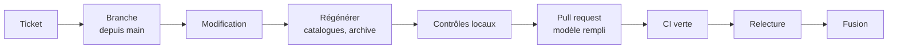

# Contribuer à Dan-Cortex

Merci de ton intérêt. Les contributions les plus utiles sont les **corrections de droit, de normes et de versions
d'outils**, les **contrôles oubliés** et les **retours d'usage réel**. Ce projet suit un
[code de conduite](CODE_OF_CONDUCT.md).

## Sommaire

1. [Avant de commencer](#1-avant-de-commencer)
2. [Flux de contribution](#2-flux-de-contribution)
3. [Où modifier quoi](#3-où-modifier-quoi)
4. [Contrôles obligatoires](#4-contrôles-obligatoires)
5. [Conventions](#5-conventions)
6. [Contenus tiers](#6-contenus-tiers)
7. [Publier une version](#7-publier-une-version)

## 1. Avant de commencer

- Cherche un ticket existant, puis ouvre-en un avec le modèle adapté (bogue, amélioration, correction de droit ou
  de norme) : un exemple reproductible et une source.
- Une faille de sécurité ne se signale jamais en public : voir [`SECURITY.md`](SECURITY.md).
- Prérequis : Git et Python 3.11 ou plus. Aucune dépendance externe pour les scripts du dépôt.

## 2. Flux de contribution



1. Crée une branche depuis `main` (`correction/jur-031-retractation`, `ajout/controle-sec-066`…).
2. Modifie, puis régénère les fichiers dérivés (section 4).
3. Ouvre une pull request en remplissant son modèle ; la CI rejoue tous les contrôles sur Python 3.11, 3.12 et 3.13.

## 3. Où modifier quoi

| Je veux… | Fichier |
|---|---|
| ajouter un contrôle | une ligne dans le `checklist-*.md` du pôle, au format des autres |
| changer ce qu'un jalon exige | `dan-cortex/skills/lancer-projet/assets/jalons.json` |
| modifier un agent | `dan-cortex/agents/<nom>.md` (modèle, effort, outils, fiche de poste) |
| ajouter un agent ou le changer de pôle | sa fiche, puis sa ligne dans `dan-cortex/skills/lancer-projet/references/organigramme.md` |
| ajouter un skill | `dan-cortex/skills/<nom>/SKILL.md` (en-tête `name` = nom du dossier), sa famille dans `scripts/generer_catalogues.py`, sa commande dans `README.md` et `dan-cortex/README.md` |
| ajouter un type de projet | un profil dans `dan-cortex/skills/lancer-projet/references/profils/` |
| modifier le paquet universel | `dan-cortex/skills/accueil-recueil/references/` ou `dan-cortex/universel/DAN-CORTEX-NOYAU.md` (8 000 caractères au plus) |
| corriger la documentation | `README.md`, `docs/*.md` (sauf les catalogues et les cartes, générés) |

## 4. Contrôles obligatoires

```
python3 dan-cortex/skills/lancer-projet/scripts/cortex.py plugin verifier   # format des 784 contrôles
python3 scripts/generer_catalogues.py                                        # catalogues et cartes SVG
python3 scripts/construire_universel.py                                      # si accueil-recueil a changé
git add -A
python3 scripts/construire_plugin.py                                         # archive dist/ (fichiers suivis)
python3 -m unittest discover -s tests -v                                     # tous les tests
```

L'archive se construit à partir des fichiers **suivis par Git** : fais `git add` avant `construire_plugin.py`.
La CI échoue si un catalogue, le paquet universel ou l'archive n'est pas à jour, si un lien relatif est mort, si
un SVG est invalide ou si un chiffre du README ne correspond plus au plugin.

## 5. Conventions

- **Langue** : français, tutoiement de l'utilisateur, phrases courtes, termes métier exacts. L'anglais est réservé
  au résumé « In English » du README et aux skills copiés d'Anthropic.
- **Identifiants** : `EX-`, `FN-`, `RG-`, `CT-`, `ADR-`… définis une seule fois, cités partout ailleurs
  (voir `dossier-projet.md`). Contrôles : trois lettres de domaine et trois chiffres (`SEC-044`).
- **Références** : une référence se charge à la demande depuis le `SKILL.md` et ne dépasse pas 1 500 mots.
- **Sources** : toute affirmation de droit, de norme ou de version cite sa source et sa date ; ce qui n'est pas
  confirmé est marqué « à vérifier ».
- **Messages de commit** : en français, préfixés de la version quand elle change (`Dan-Cortex 2.2.0 : …`).
- **Interdits** : vrai secret, invite privée, donnée personnelle, charge utile visant un système tiers, adresse
  électronique personnelle.

## 6. Contenus tiers

Tout apport venu d'un dépôt public suit
[`renfort-externe.md`](dan-cortex/skills/robustesse-agents/references/renfort-externe.md) : forme A (méthode
réécrite) ou forme B (texte traduit, licence permissive, `NOTICE.md`), jamais de hook, de script tiers ni d'appel
réseau automatique. Les treize skills copiés d'anthropics/skills ne se modifient pas : leur mise à jour se fait par
une nouvelle copie complète, consignée dans `dan-cortex/NOTICE.md`.

Le mode autonome ne s'élargit jamais en retirant une limite dure : une nouvelle délégation passe par les
autorisations permanentes écrites à J0. Ne relance pas un ancien paquet de mise à jour
(`dan-cortex-update-1.3.0`) : son script réécrit la version.

## 7. Publier une version

1. Choisir le numéro selon le [versionnage sémantique](https://semver.org/lang/fr/).
2. Le reporter dans `dan-cortex/.claude-plugin/plugin.json`, `.claude-plugin/marketplace.json` (deux champs) et
   le badge `version` du README.
3. Ouvrir la section `## [x.y.z] - AAAA-MM-JJ` en tête de `CHANGELOG.md` (les tests l'exigent).
4. Relancer les contrôles de la section 4, puis ouvrir la pull request.
