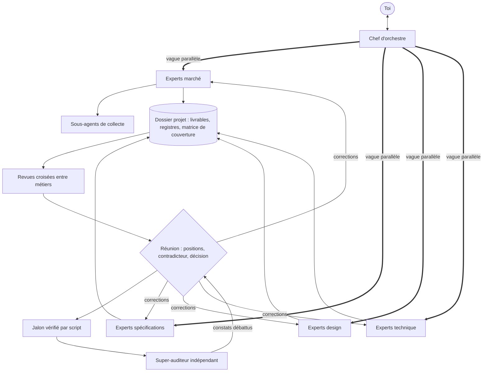

<h1 align="center">Cortex</h1>

<p align="center"><strong>Le réseau d'agents experts qui lance vos projets numériques avec Claude.</strong></p>

<p align="center">
  
  
  
  
  
  
</p>

Cortex est un plugin pour Claude. Il organise 45 agents experts comme les équipes d'une vraie
entreprise pour cadrer, concevoir, réaliser, tester, sécuriser et lancer un projet numérique : site web de grande
entreprise, application mobile, SaaS, produit de niche, e-commerce, ERP. Les agents travaillent en parallèle, se
relisent entre métiers, débattent des décisions structurantes, et un auditeur indépendant passe tout en revue
avant le lancement. Une matrice de 768 contrôles garantit que rien n'est oublié : technique,
sécurité, juridique, pénal, financier, marketing, social, culturel, politique.

> Cortex prépare, vérifie et rédige. Il ne remplace ni un avocat, ni un expert-comptable, ni un auditeur de
> sécurité qualifié : ce qui engage est marqué « à valider ».

## Installer

**Dans Claude Code**

```
/plugin marketplace add aksilsmd/cortex
/plugin install cortex@cortex-projets
```

**Dans l'application Claude** (web et bureau, offres payantes)

1. Ouvre le menu **Customize** (Personnaliser), onglet **Plugins**.
2. Clique sur **Add** → **Add marketplace** → **Add from a repository**, puis saisis `aksilsmd/cortex`.
3. Sélectionne le plugin **cortex** et clique sur **Add**.

Autre voie : télécharge [`dist/cortex.plugin`](dist/cortex.plugin) et téléverse-le comme plugin personnalisé.
Les libellés du menu peuvent être traduits dans ton application.

Prérequis : Python 3 pour les scripts de pilotage (bibliothèque standard uniquement).

## Démarrer

```
/cortex:lancer-projet Je veux lancer <ton projet>, pour <qui>, dans <quels pays>, avec <budget et délai>.
```

Le chef d'orchestre pose une seule série de questions, crée le dossier du projet, compose l'équipe et déroule
les jalons. Tu peux t'arrêter à n'importe lequel.

| Jalon | Question tranchée |
|---|---|
| J1 Opportunité | Faut-il y aller, et sous quel angle ? |
| J2 Cadrage | Quoi, pour qui, combien, quand ? |
| J3 Conception | Comment exactement ? |
| J4 Réalisation | Est-ce construit et testé ? |
| J5 Validation | Est-ce prêt ? |
| J6 Lancement | Lancer et tenir |
| J7 Bilan | Qu'a-t-on appris ? |

Trois modes règlent l'ampleur et le coût : `eclair` (3 à 4 agents par vague, contrôles bloquants seulement),
`standard` (6 à 8), `integral` (10 à 16, pour les grands comptes et les secteurs régulés).

## Comment ça marche



- **Un chef d'orchestre** parle avec toi et lance les agents par vagues parallèles.
- **Des orchestrateurs de pôle** découpent le travail en ordres de mission ; **des sous-agents légers** font la
  collecte et l'exécution.
- **Des réunions écrites** tranchent les choix structurants : positions séparées, contradicteur, deux tours au
  plus, décision tracée. Les décisions irréversibles te reviennent.
- **Des revues croisées** : le juriste relit le marketing, le testeur relit les spécifications, la sécurité
  relit l'architecture.
- **Un super-auditeur** indépendant audite tout avant le lancement ; son rapport est débattu en plénière, puis
  les corrections sont décidées et recontrôlées.
- **Un script** tient les registres, vérifie les jalons, la traçabilité des exigences jusqu'aux tests, et la
  cohérence des interactions : aucun bouton sans destination, aucun écran orphelin.

## Les pôles

| Pôle | Commande | Ce qu'il produit |
|---|---|---|
| Pilotage | `/cortex:lancer-projet` | fiche projet, organigramme, planning, registres, tableau de bord |
| Stratégie et marché | `/cortex:veille-marche` | étude de marché, benchmark des concurrents, voix du client, contexte, positionnement |
| Besoin et spécifications | `/cortex:specifications` | note de cadrage, cahier des charges, spécifications générales, détaillées et techniques |
| Design et expérience | `/cortex:maquettes-parcours` | workflows, matrice d'interactions, maquettes, thème, accessibilité, localisation |
| Architecture et normes | `/cortex:architecture-normes` | choix du langage et de la pile, architecture, schéma de données, normes, infrastructure |
| Réalisation et qualité | `/cortex:usine-logicielle` | code par lots, tests unitaires, fonctionnels, d'API, de bout en bout, recette |
| Sécurité | `/cortex:securite-protection` | analyse de risques, protections, tests de sécurité, cadrage d'un test d'intrusion |
| Juridique et conformité | `/cortex:juridique-conformite` | données personnelles, commerce, contrats, propriété intellectuelle, pénal, fiscalité |
| Finance | `/cortex:budget-finance` | estimation, budget complet, justification économique, financements |
| Marketing et commercial | `/cortex:marketing-commercial` | mise sur le marché, acquisition, prix, vente, plan de lancement |
| Lancement et exploitation | `/cortex:lancement-exploitation` | go/no-go, plan de bascule, mise en production, support, bilan |
| Réunions | `/cortex:reunion-decision` | débat entre experts et décision tracée |
| Audit | `/cortex:audit-general` | audit à 360° d'un projet, mené avec Cortex ou non |

## Sobriété en tokens

Un système multi-agents coûte plus cher qu'une conversation simple. Cortex réduit ce coût par construction.

| Mesure (octobre 2026, session très équipée) | Valeur |
|---|---|
| Contexte de départ d'un agent généraliste | environ 90 000 tokens |
| Contexte de départ d'un agent Cortex | environ 6 000 tokens |
| Coût permanent du plugin par session | environ 3 601 tokens |

- Chaque agent n'a que les outils de son métier et précharge le seul skill de son pôle.
- Collecte et exécution sur le modèle léger, production sur le modèle intermédiaire, jugement sur le modèle de la
  session.
- Les agents se parlent par fichiers ; le chef d'orchestre ne lit que des comptes rendus de 150 mots.
- Tout ce qui se compte ou se vérifie passe par un script, pas par un modèle.
- Un plafond de tokens par projet, avec alerte à 80 % et à 100 %.

## État de validation

Cette version est une première version publique. Ce qui a été vérifié :

- structure du plugin validée par `claude plugin validate --strict` ; format des 768 contrôles
  vérifié par script ;
- scripts de pilotage testés sur un projet d'essai : matrice de couverture, registres, jalons, traçabilité,
  cohérence des interactions ;
- un essai en conditions réelles sur le jalon J1 en mode `eclair`, décrit dans
  [`docs/essai-a-blanc.md`](docs/essai-a-blanc.md) ;
- un audit indépendant du plugin par rapport à son cahier des charges.

Ce qui ne l'a pas encore été : un projet complet mené de J2 à J7. Les retours sont les bienvenus.

## Limites

- Les références de droit, de normes et d'outils sont à l'état d'octobre 2026, France et Union européenne
  d'abord. Les points que la recherche n'a pas pu confirmer sont marqués « à vérifier » dans les fichiers.
- Aucun effet extérieur sans accord explicite : ni achat, ni publication, ni envoi, ni push, ni déploiement.
- Les tests de sécurité ne visent que les environnements du projet, avec autorisation écrite de leur
  propriétaire. Le plugin ne contient aucune technique d'attaque.
- Dans l'application Claude, un agent ne peut pas en lancer d'autres : le chef d'orchestre lance tout le monde.
- Un grand projet dépasse une session : l'état du dossier projet permet de reprendre où l'on s'est arrêté.

## Contenu du dépôt

| Chemin | Contenu |
|---|---|
| `cortex/` | le plugin : 13 skills, 45 agents, 119 fichiers de référence, 2 scripts |
| `dist/cortex.plugin` | le plugin empaqueté pour l'application Claude |
| `docs/expertise.md` | le rapport d'expertise qui a servi à le construire, avec ses sources |
| `docs/essai-a-blanc.md` | le compte rendu de l'essai en conditions réelles |

## Adapter et contribuer

- Ajouter un contrôle : une ligne dans le fichier `checklist-*.md` du pôle, puis
  `python3 cortex/skills/lancer-projet/scripts/cortex.py plugin verifier`.
- Changer ce qu'un jalon exige : `cortex/skills/lancer-projet/assets/jalons.json`.
- Modifier un agent : son fichier dans `cortex/agents/`.
- Ajouter un type de projet : un profil dans `cortex/skills/lancer-projet/references/profils/`.

Les corrections de droit, de normes et de versions d'outils sont particulièrement utiles : ouvre un ticket en
citant le texte ou la source.

## Licence

MIT. Voir [`LICENSE`](LICENSE).

---

## In English

**Cortex** is a Claude plugin that runs a network of 45 expert agents, organised like a real company,
to scope, design, build, test, secure and launch a digital project: enterprise website, mobile app, SaaS, niche
product, e-commerce, ERP. Agents work in parallel waves, cross-review each other's deliverables, debate
structural decisions in bounded written meetings, and an independent auditor reviews everything before launch. A
coverage matrix of 768 controls makes sure nothing is forgotten, from security and law to budget,
marketing and cultural adaptation.

It is built for low token use: each agent starts with about 6,000 tokens of context instead of about 90,000 for a
general-purpose agent, deterministic checks run in scripts, and agents talk through files.

The plugin content is written in French, with French and EU law first. Install it with
`/plugin marketplace add aksilsmd/cortex` then `/plugin install cortex@cortex-projets` in Claude Code, or in the Claude
app with Customize → Plugins → Add → Add marketplace → Add from a repository (`aksilsmd/cortex`). Start with
`/cortex:lancer-projet`.

Cortex prepares and checks; it does not replace a lawyer, an accountant or a qualified security auditor.
