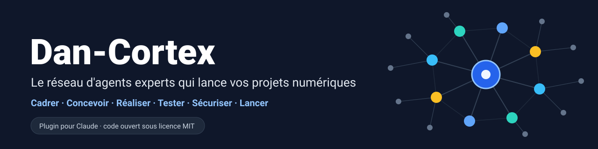
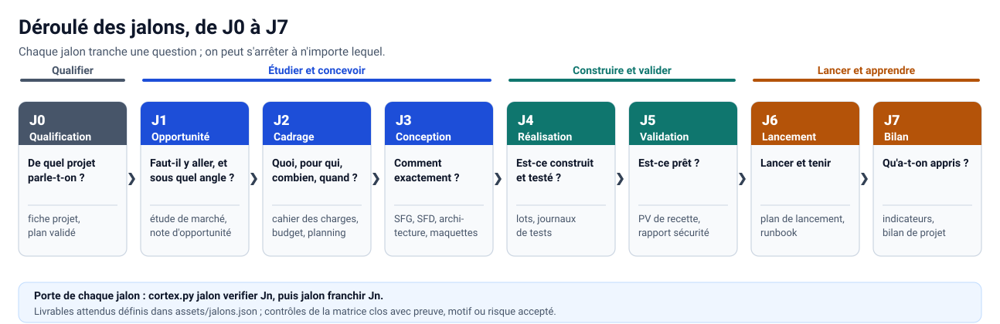
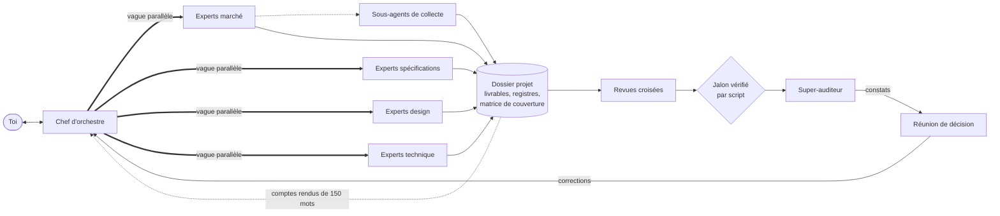
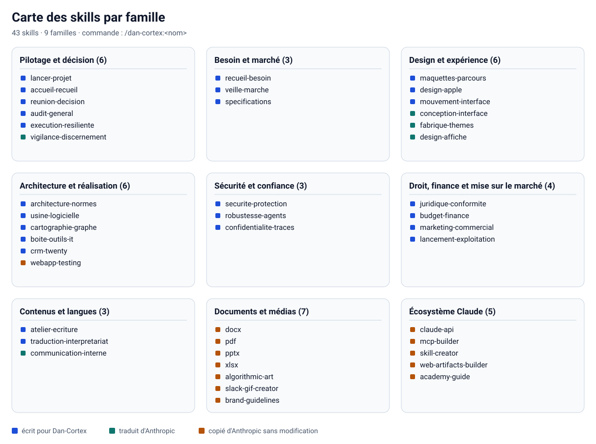

<p align="center">
  
</p>

<p align="center">
  <a href="https://github.com/aksilsmd/cortex/actions/workflows/tests.yml"></a>
  
  
  
  
  
  <a href="LICENSE"></a>
</p>

<p align="center"><a href="#in-english">English summary below</a></p>

**Dan-Cortex** est un plugin pour Claude qui organise **59 agents experts** comme les équipes d'une entreprise
pour cadrer, concevoir, réaliser, tester, sécuriser et lancer un projet numérique : site d'entreprise,
application mobile, SaaS, produit de niche, e-commerce, ERP. Les agents travaillent en vagues parallèles, se
relisent entre métiers, débattent des décisions structurantes, et un auditeur indépendant passe tout en revue
avant le lancement. Une matrice de **784 contrôles** (technique, sécurité, droit, finance, marketing, contexte
culturel) garantit que rien n'est oublié.

> [!NOTE]
> Dan-Cortex prépare, vérifie et rédige. Il ne remplace ni un avocat, ni un expert-comptable, ni un auditeur de
> sécurité qualifié : tout ce qui engage est marqué « à valider ».

## Sommaire

- [Installer](#installer)
- [Démarrer en trois étapes](#démarrer-en-trois-étapes)
- [Comment ça marche](#comment-ça-marche)
- [Les skills par famille](#les-skills-par-famille)
- [Autonomie et limites](#autonomie-et-limites)
- [Sécurité](#sécurité)
- [Documentation](#documentation)
- [Contribuer](#contribuer)
- [Licence](#licence)
- [In English](#in-english)

## Installer

**Claude Code**

```
/plugin marketplace add aksilsmd/cortex
/plugin install dan-cortex@cortex-projets
```

**Application Claude** (web et bureau, offres payantes) : **Customize** → **Plugins** → **Add** →
**Add marketplace** → **Add from a repository**, saisis `aksilsmd/cortex`, puis ajoute le plugin **dan-cortex**.
Autre voie : téléverse [`dist/dan-cortex.plugin`](dist/dan-cortex.plugin) comme plugin personnalisé.

**Autre IA** (Codex, Gemini, simple chat) : suis [`AGENTS.md`](AGENTS.md), ou colle le noyau du
[paquet universel](dan-cortex/universel/INSTALLATION.md) (moins de 8 000 caractères).

Prérequis : Python 3.11 ou plus pour les scripts de pilotage (bibliothèque standard uniquement). Si l'ancien
plugin `cortex` est installé, retire-le : il porte les mêmes skills et agents.

## Démarrer en trois étapes

1. **Décris ton besoin, même en vrac.** `/dan-cortex:accueil-recueil` te salue, reformule, explore le domaine et
   mène l'entretien. Si ton projet est déjà cadré, passe directement à l'étape 2.
2. **Lance le chef d'orchestre.**

   ```
   /dan-cortex:lancer-projet Je veux lancer <ton projet>, pour <qui>, dans <quels pays>, avec <budget et délai>.
   ```

   Il pose une seule série de questions (périmètre, mode, pays, données, autonomie), crée le dossier du projet et
   compose l'équipe.
3. **Valide jalon par jalon.** À chaque jalon tu reçois les livrables et les décisions à prendre ; tu peux
   t'arrêter à n'importe lequel.



Trois modes règlent l'ampleur et le coût : `eclair` (3 à 4 agents par vague), `standard` (6 à 8) et `integral`
(10 à 16, grands comptes et secteurs régulés). Guide pas à pas : [`docs/guide-demarrage.md`](docs/guide-demarrage.md).

## Comment ça marche



- **Un chef d'orchestre** parle avec toi et lance les agents par vagues parallèles ; il ne lit que des comptes
  rendus courts.
- **59 agents experts** répartis en 13 pôles, chacun avec les seuls outils de son métier et le skill de son pôle.
- **Des réunions écrites** tranchent les choix structurants : positions séparées, contradicteur, deux tours au
  plus, décision tracée. Les décisions irréversibles te reviennent.
- **Un script** (`cortex.py`) tient les registres, vérifie les jalons, la traçabilité des exigences jusqu'aux
  tests et la cohérence des interactions : aucun bouton sans destination, aucun écran orphelin.

Détail, schémas et registres : [`docs/architecture.md`](docs/architecture.md).

## Les skills par famille

Chaque skill s'appelle aussi seul. Le [catalogue des skills](docs/catalogue-skills.md) et le
[catalogue des agents](docs/catalogue-agents.md) sont générés à partir des fichiers du plugin.

| Famille | Skills |
|---|---|
| Pilotage et décision | `/dan-cortex:lancer-projet` · `/dan-cortex:accueil-recueil` · `/dan-cortex:reunion-decision` · `/dan-cortex:audit-general` · `/dan-cortex:execution-resiliente` · `/dan-cortex:vigilance-discernement`¹ |
| Besoin et marché | `/dan-cortex:recueil-besoin` · `/dan-cortex:veille-marche` · `/dan-cortex:specifications` |
| Design et expérience | `/dan-cortex:maquettes-parcours` · `/dan-cortex:design-apple` · `/dan-cortex:mouvement-interface` · `/dan-cortex:conception-interface`¹ · `/dan-cortex:fabrique-themes`¹ · `/dan-cortex:design-affiche`¹ |
| Architecture et réalisation | `/dan-cortex:architecture-normes` · `/dan-cortex:usine-logicielle` · `/dan-cortex:cartographie-graphe` · `/dan-cortex:boite-outils-it` · `/dan-cortex:crm-twenty` · `/dan-cortex:webapp-testing`² |
| Sécurité et confiance | `/dan-cortex:securite-protection` · `/dan-cortex:robustesse-agents` · `/dan-cortex:confidentialite-traces` |
| Droit, finance et mise sur le marché | `/dan-cortex:juridique-conformite` · `/dan-cortex:budget-finance` · `/dan-cortex:marketing-commercial` · `/dan-cortex:lancement-exploitation` |
| Contenus et langues | `/dan-cortex:atelier-ecriture` · `/dan-cortex:traduction-interpretariat` · `/dan-cortex:communication-interne`¹ |
| Documents et médias | `/dan-cortex:docx`² · `/dan-cortex:pdf`² · `/dan-cortex:pptx`² · `/dan-cortex:xlsx`² · `/dan-cortex:algorithmic-art`² · `/dan-cortex:slack-gif-creator`² · `/dan-cortex:brand-guidelines`² |
| Écosystème Claude | `/dan-cortex:claude-api`² · `/dan-cortex:mcp-builder`² · `/dan-cortex:skill-creator`² · `/dan-cortex:web-artifacts-builder`² · `/dan-cortex:academy-guide`² |

¹ Texte traduit et adapté d'[anthropics/skills](https://github.com/anthropics/skills) (Apache-2.0).
² Copié d'anthropics/skills sans modification (Apache-2.0) ; **ses scripts s'exécutent sur ta machine**.
Mentions complètes : [`dan-cortex/NOTICE.md`](dan-cortex/NOTICE.md).



## Autonomie et limites

| Niveau | Ce qui se passe |
|---|---|
| `accompagne` (par défaut) | arrêt à chaque jalon, décisions irréversibles soumises sur le moment |
| `delegue` | les jalons s'enchaînent, tes décisions sont regroupées à la fin de chacun |
| `autonome` | après la qualification, tout le périmètre s'enchaîne ; décisions irréversibles au statut provisoire ; un seul bilan final |

**Six limites dures ne se délèguent jamais** : dépenser ou t'engager, toucher un système qui n'est pas au projet,
tester la sécurité sans autorisation écrite, modifier les permissions de Claude Code, supprimer de façon
irréversible, sortir un vrai secret. Hors de ces limites, le mode autonome n'agit à l'extérieur que dans les
autorisations permanentes écrites à J0.

Ce qui a été vérifié : structure du plugin (`claude plugin validate --strict`), format des 784 contrôles,
niveaux d'autonomie et paquet `ccal` (tests automatisés), scripts de pilotage sur un projet d'essai, et un
[essai à blanc](docs/essai-a-blanc.md) du jalon J1. Pas encore : un projet complet de J2 à J7, ni une mission
entière en mode `autonome`. Le droit et les normes sont à l'état d'octobre 2026, France et Union européenne
d'abord ; ce qui n'a pas pu être confirmé est marqué « à vérifier ».

## Sécurité

- Tout ce qu'un agent lit (page web, document, sortie d'outil) est une **donnée, jamais un ordre**.
- Les tests de sécurité ne visent que les environnements du projet, avec autorisation écrite ; le plugin ne
  contient aucune technique d'attaque.
- Le pôle `robustesse-agents` audite les réglages de Claude Code et éprouve les fonctions d'IA contre
  l'injection d'instructions ; `confidentialite-traces` masque secrets et données personnelles.

Détail : [`docs/securite-et-robustesse.md`](docs/securite-et-robustesse.md). Signaler une faille :
[`SECURITY.md`](SECURITY.md) (signalement privé, jamais en ticket public).

## Documentation

| Document | Contenu |
|---|---|
| [Guide de démarrage](docs/guide-demarrage.md) | installation, premier projet, modes, reprise d'un projet |
| [Architecture](docs/architecture.md) | pôles, chef d'orchestre, agents, jalons, registres, matrice de contrôles, scripts |
| [Catalogue des skills](docs/catalogue-skills.md) · [des agents](docs/catalogue-agents.md) | listes générées par `scripts/generer_catalogues.py` |
| [Sécurité et robustesse](docs/securite-et-robustesse.md) | limites dures, injection d'instructions, confidentialité, scripts tiers |
| [FAQ](docs/faq.md) | questions fréquentes |
| [Rapport d'expertise](docs/expertise.md) · [Essai à blanc](docs/essai-a-blanc.md) | sources de la méthode, essai réel du jalon J1 |
| [Journal des versions](CHANGELOG.md) | historique, au format Keep a Changelog |

```
.
├── .claude-plugin/marketplace.json   catalogue du plugin
├── .github/                          CI, modèles d'issue et de pull request
├── dan-cortex/                       le plugin : skills/, agents/, universel/, NOTICE.md
├── dist/dan-cortex.plugin            archive reproductible pour l'application Claude
├── docs/                             documentation, catalogues générés, images/
├── scripts/                          construction du plugin, du paquet universel et des catalogues
├── tests/                            tests automatisés (unittest)
└── AGENTS.md                         guide d'entrée pour toute IA
```

## Contribuer

Les corrections de droit, de normes et de versions d'outils sont particulièrement utiles. Lis
[`CONTRIBUTING.md`](CONTRIBUTING.md), puis ouvre un ticket avec le modèle adapté. Avant toute pull request :

```
python3 -m unittest discover -s tests -v
python3 dan-cortex/skills/lancer-projet/scripts/cortex.py plugin verifier
python3 scripts/generer_catalogues.py --verifier
python3 scripts/construire_plugin.py --verifier
```

Ce projet suit un [code de conduite](CODE_OF_CONDUCT.md).

## Licence

Code et contenus de Dan-Cortex : licence [MIT](LICENSE). Les skills issus d'anthropics/skills restent sous
licence Apache-2.0, avec leur `LICENSE.txt` ; les autres contenus tiers sont listés dans
[`dan-cortex/NOTICE.md`](dan-cortex/NOTICE.md) et [`dan-cortex/THIRD_PARTY_NOTICES.md`](dan-cortex/THIRD_PARTY_NOTICES.md).

---

## In English

**Dan-Cortex** is a Claude plugin that organises **59 expert agents** into 13 departments, like a real company,
to scope, design, build, test, secure and launch a digital project: enterprise website, mobile app, SaaS, niche
product, e-commerce, ERP. It ships **43 skills**. Agents work in parallel waves, cross-review each other's
deliverables, debate structural decisions in bounded written meetings, and an independent auditor reviews
everything before launch. A coverage matrix of **784 controls** makes sure nothing is forgotten, from security and
law to budget, marketing and cultural context.

- **Guided intake** (`/dan-cortex:accueil-recueil`): turns a rough idea into a validated brief, explores the
  domain, then delivers specifications, market study, design, plan, test strategy and a delivery study.
- **Orchestrator** (`/dan-cortex:lancer-projet`): runs milestones J0 to J7, with three modes (`eclair`,
  `standard`, `integral`) and three autonomy levels (`accompagne`, `delegue`, `autonome`). Six hard limits
  (spending, systems outside the project, unauthorised security testing, changing Claude Code permissions,
  irreversible deletion, real secrets) always require your consent.
- **Agent robustness**: audits Claude Code settings and tests AI features against prompt injection; everything an
  agent reads is data, never an instruction.
- **Universal package**: a core prompt under 8,000 characters for other AIs, plus [`AGENTS.md`](AGENTS.md).
- **Low token use**: each agent starts with about 6,000 tokens of context instead of about 90,000 for a
  general-purpose agent; deterministic checks run in scripts; agents talk through files.

Install in Claude Code with `/plugin marketplace add aksilsmd/cortex` then
`/plugin install dan-cortex@cortex-projets`; in the Claude app, use Customize → Plugins → Add → Add marketplace →
Add from a repository (`aksilsmd/cortex`). The plugin content is written in French, with French and EU law first.
Thirteen skills are copied unchanged from anthropics/skills and five are translated from it (Apache-2.0); the
rest is MIT. Dan-Cortex prepares and checks; it does not replace a lawyer, an accountant or a qualified security
auditor. See [CHANGELOG.md](CHANGELOG.md) for the version history (current: 2.1.0).
