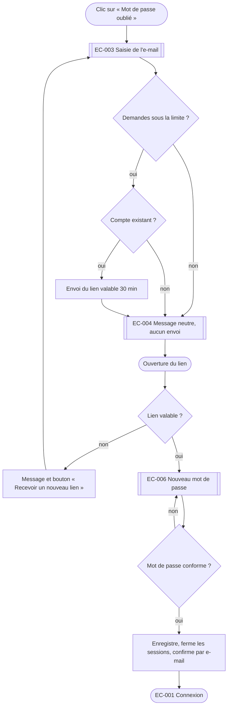

# Workflows fonctionnels

Un workflow décrit, étape par étape, comment une personne accomplit une chose avec le produit, et tout ce qui
peut dévier. Il y a un workflow par fonctionnalité, pas un par écran. C'est le pont entre les règles de gestion
(SFD), les écrans (matrice d'interactions) et les tests (cahier de recette).

## Sommaire
1. Format imposé
2. Méthode
3. Conventions de schéma
4. Exemple complet
5. Contrôles avant de rendre

## 1. Format imposé

Fichier par module : `03-conception/design/workflows/<module>.md`. Chaque workflow est une section dont le titre
commence par son identifiant : c'est ce titre que lit le script de traçabilité.

````markdown
## WF-002 — Réinitialiser son mot de passe

| | |
|---|---|
| Fonction | FN-002 |
| Acteur | visiteur qui possède un compte |
| Déclencheur | clic sur « Mot de passe oublié » (EL-001-06) |
| Préconditions | aucune |
| Résultat attendu | le mot de passe est changé, les autres sessions sont fermées |
| Règles de gestion | RG-010, RG-011, RG-012 |
| Fréquence et enjeu | occasionnel ; bloquant pour l'accès au compte |

### Étapes
| N° | Qui | Action | Réponse du système | Écran |
|---|---|---|---|---|
| 1 | Visiteur | saisit son e-mail et valide | envoie un lien à usage unique valable 30 minutes | EC-003 → EC-004 |

### Exceptions
| Code | À l'étape | Condition | Réponse du système | Suite |
|---|---|---|---|---|
| E1 | 1 | e-mail inconnu | même message que si le compte existait, aucun envoi | fin |

### Schéma
```mermaid
flowchart TD
  …
```
````

Tout identifiant cité dans la section (`FN-`, `RG-`, `EC-`, `EL-`) est relié au workflow par le script : citer
ceux qui s'appliquent, et seulement ceux-là.

## 2. Méthode

1. **Lister les fonctionnalités** à partir de la SFG : une fonction `FN-` donne un ou plusieurs workflows.
   Ajouter les workflows transverses que les spécifications oublient souvent : première utilisation, connexion et
   déconnexion, récupération de compte, changement d'e-mail, suppression de compte, export de ses données,
   consentement, paiement échoué, résiliation, notification reçue, reprise après interruption.
2. **Écrire le chemin nominal** en verbes d'action, une action par étape, du déclencheur au résultat.
3. **Chercher les déviations à chaque étape** avec cinq questions : et si la donnée est absente ou invalide ?
   et si la personne n'a pas le droit ? et si le système ou le réseau ne répond pas ? et si elle abandonne ou
   revient en arrière ? et si elle fait deux fois la même chose ?
4. **Rattacher** chaque étape à son écran et chaque décision à sa règle de gestion. Une décision sans règle est
   une règle manquante : la signaler au `redacteur-sfd`.
5. **Schématiser** avec les conventions ci-dessous.
6. **Relire avec la matrice d'interactions** : chaque flèche du schéma correspond à au moins un élément `EL-`.

## 3. Conventions de schéma

Mermaid, lisible dans tout éditeur Markdown.

| Besoin | Diagramme | Usage |
|---|---|---|
| Enchaînement d'étapes et de décisions | `flowchart TD` | le cas général |
| Échanges entre l'utilisateur, l'interface, le serveur, un service tiers | `sequenceDiagram` | paiement, authentification déléguée, envoi d'e-mail |
| Objet qui change d'état (commande, abonnement, ticket, document) | `stateDiagram-v2` | cycle de vie, avec les transitions interdites |
| Processus métier entre plusieurs services d'une entreprise | `flowchart LR` avec un `subgraph` par acteur | ERP, validation à plusieurs niveaux |

Formes : `([Début])` et `([Fin])` arrondis ; `[Action]` rectangle ; `{Décision ?}` losange, toujours avec une
branche par issue ; écran entre doubles crochets `[[EC-003 Mot de passe oublié]]`. Étiqueter chaque flèche qui
sort d'une décision. Au plus quinze nœuds par schéma : au-delà, découper en sous-workflows.

## 4. Exemple complet

````markdown
## WF-002 — Réinitialiser son mot de passe

| | |
|---|---|
| Fonction | FN-002 |
| Acteur | visiteur qui possède un compte |
| Déclencheur | clic sur « Mot de passe oublié » (EL-001-06) |
| Préconditions | aucune |
| Résultat attendu | le mot de passe est changé, les autres sessions sont fermées, un e-mail le confirme |
| Règles de gestion | RG-010 (durée du lien), RG-011 (robustesse du mot de passe), RG-012 (limite de demandes) |
| Fréquence et enjeu | occasionnel ; bloquant pour l'accès au compte |

### Étapes
| N° | Qui | Action | Réponse du système | Écran |
|---|---|---|---|---|
| 1 | Visiteur | saisit son e-mail et clique « Envoyer le lien » | envoie un lien à usage unique valable 30 minutes | EC-003 → EC-004 |
| 2 | Visiteur | ouvre le lien reçu | vérifie le lien, affiche le formulaire | EC-006 |
| 3 | Visiteur | saisit deux fois le nouveau mot de passe et valide | contrôle la robustesse, enregistre, ferme les autres sessions, envoie l'e-mail de confirmation | EC-006 → EC-001 |
| 4 | Visiteur | se connecte avec le nouveau mot de passe | ouvre la session | EC-001 → EC-002 |

### Exceptions
| Code | À l'étape | Condition | Réponse du système | Suite |
|---|---|---|---|---|
| E1 | 1 | e-mail inconnu | même écran et même message que si le compte existait ; aucun envoi | fin |
| E2 | 1 | plus de 3 demandes en une heure | même message ; aucun envoi ; événement journalisé | fin |
| E3 | 2 | lien expiré ou déjà utilisé | « Ce lien n'est plus valable » et bouton « Recevoir un nouveau lien » | retour à l'étape 1 |
| E4 | 3 | mot de passe trop faible ou confirmations différentes | message sous le champ, saisie conservée | reste à l'étape 3 |
| E5 | 3 | service indisponible | « Enregistrement impossible, réessayez » ; rien n'est modifié | reste à l'étape 3 |

### Schéma

````

## 5. Contrôles avant de rendre

- Chaque fonction de la SFG a au moins un workflow ; chaque workflow cite sa fonction.
- Chaque étape a un écran ; chaque décision a une règle de gestion ou une demande de règle.
- Chaque exception dit ce que voit la personne et où elle se retrouve ensuite.
- Aucune branche du schéma ne se termine dans le vide.
- Les workflows transverses de la méthode sont présents ou écartés avec un motif.
- `cortex.py tracabilite verifier` ne signale ni fonction sans workflow ou règle, ni workflow sans cas de test
  une fois le cahier de recette écrit.
