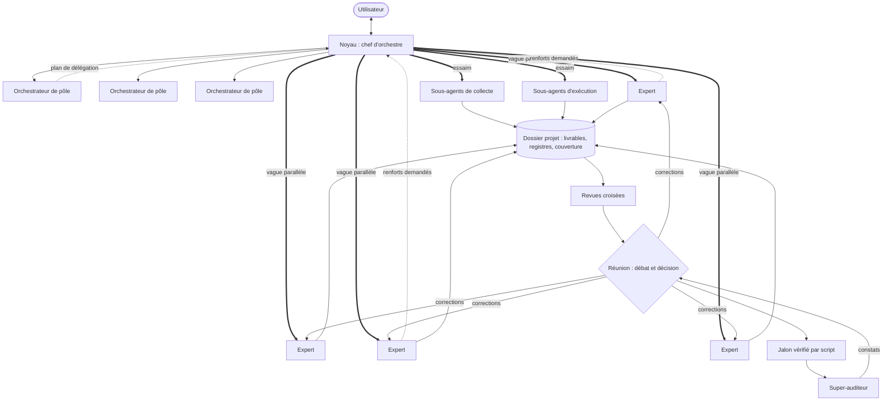

# Comment fonctionne le réseau

Dan-Cortex est organisé comme un réseau de neurones : des unités spécialisées, reliées par des connexions simples,
qui travaillent en même temps et se corrigent mutuellement. La comparaison n'est pas décorative : chaque notion
correspond à un mécanisme précis.

| Dans un réseau de neurones | Dans Dan-Cortex |
|---|---|
| Neurone | un agent expert, avec ses compétences (le skill de son pôle) et ses outils |
| Synapse | l'ordre de mission à l'aller, le compte rendu au retour, les fichiers du dossier projet entre les deux |
| Couche d'entrée | les capteurs : analystes et collecteurs qui lisent le marché, les concurrents, les avis, le droit |
| Couches cachées | les pôles qui transforment : spécifications, design, architecture, réalisation, tests |
| Couche de sortie | les décisions, les livrables, le produit lancé |
| Propagation avant | une vague : tous les agents indépendants lancés au même instant |
| Connexions latérales | les revues croisées : un métier relit le livrable d'un autre |
| Fonction d'erreur | l'audit général : l'écart entre ce qui est produit et ce qui était attendu |
| Rétropropagation | les constats d'audit renvoyés aux auteurs, corrigés, puis recontrôlés |
| Poids | l'autorité de chaque avis en réunion : le métier concerné pèse plus lourd, la preuve plus que l'opinion |
| Activation parcimonieuse | seuls les agents utiles au projet s'activent : c'est ce qui rend le réseau sobre |

## Schéma

## Pourquoi c'est rapide

Le temps d'une vague est celui de son agent le plus lent, pas la somme de tous. Dix analyses d'un quart d'heure
prennent un quart d'heure. La seule chose qui se fait en série est ce qui dépend réellement d'un résultat
précédent : la synthèse après la collecte, le détail après le général, la correction après l'audit.

## Pourquoi c'est sobre

- Chaque agent démarre avec un contexte minuscule : ses outils de métier et le skill de son pôle, rien d'autre.
- Les agents se parlent par fichiers : personne ne porte dans son contexte le travail des autres.
- Le noyau ne lit que des comptes rendus de 150 mots et des synthèses de 12 lignes.
- Tout ce qui se compte ou se vérifie mécaniquement est fait par un script, pas par un modèle.
- Les tâches simples vont au modèle léger, le jugement au modèle le plus capable.

## Pourquoi les décisions sont meilleures

Un agent seul se relit mal. Dans Dan-Cortex, aucune décision structurante n'est prise sans que des métiers
différents aient écrit leur position séparément, qu'un contradicteur ait cherché la faille, et que le décideur
ait tranché par écrit en gardant trace des désaccords. Et rien ne part en production sans qu'un auditeur qui n'a
rien produit ait tout passé en revue.

## Les limites à connaître

- Dans l'application Claude, un agent ne peut pas en lancer d'autres : la hiérarchie passe par le noyau, qui
  lance tout le monde à la demande des orchestrateurs. En ligne de commande, l'imbrication peut être permise.
- Les agents sont des modèles : ils préparent, vérifient et rédigent, mais un avocat, un expert-comptable ou un
  auditeur certifié restent nécessaires pour valider ce qui engage juridiquement ou financièrement.
- Un projet d'envergure dépasse une session : l'état du dossier projet permet de reprendre exactement là où
  l'on s'est arrêté.
