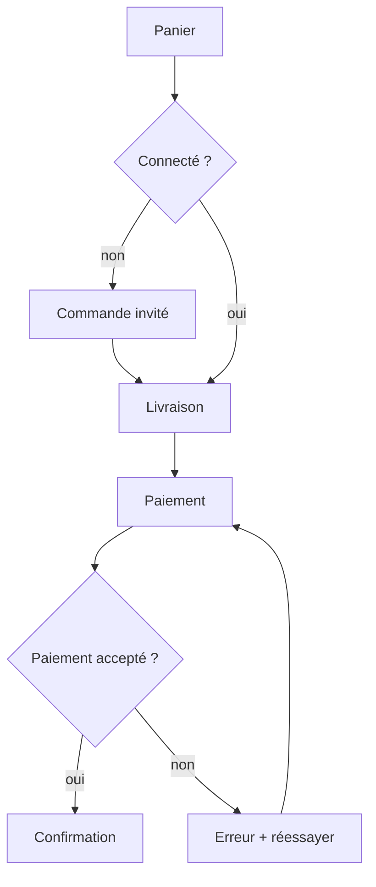
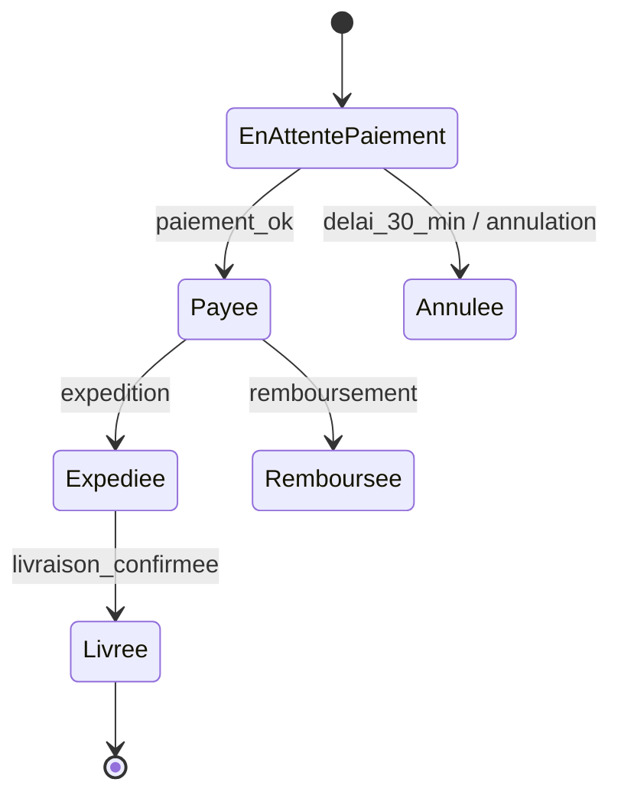

# Formation — Figma et modélisation des parcours et workflows

Fiche de formation pour maquettiste, concepteur UX, cartographe des interactions, développeurs front et mobile, testeurs et expert accessibilité. Elle complète `maquettes.md` (fichiers autonomes, annotations, passation), `workflows-fonctionnels.md` (format WF imposé), `matrice-interactions.md` (format imposé) et `theme-design-system.md`. Sources en fin de fiche (consultées le 2026-11-03) ; collecte : `sources/figma-workflows.md`.

Rappel du pôle : les agents produisent des maquettes en fichiers autonomes ; Figma est l'outil de l'équipe humaine ou du client. Aucun compte n'est créé par un agent. Un agent qui dispose d'un accès Figma fourni par l'utilisateur (serveur MCP) l'emploie en lecture/écriture dans le fichier désigné uniquement.

## Sommaire
1. Objectifs
2. Organisation d'un fichier et d'une bibliothèque
3. Auto layout
4. Composants, variantes, propriétés
5. Variables, modes, styles
6. Prototypage
7. Dev Mode, handoff, Code Connect, serveur MCP
8. Modéliser les parcours et workflows
9. Du modèle aux tests
10. Check-list d'audit
11. Anti-patterns et pièges
12. Sources

## 1. Objectifs

L'agent sait :
- structurer un fichier Figma lisible par un développeur (pages, sections, nommage, statut) ;
- construire des composants responsives (auto layout) et des variantes alignées sur les composants du code ;
- traduire les jetons du système de design en variables et modes (thème, densité, langue) ;
- préparer le handoff (Dev Mode, statuts « prêt pour le dev », Code Connect) ;
- modéliser un parcours au bon niveau : carte de parcours, user flow, diagramme d'états, BPMN léger, matrice écran-action ;
- dériver des cas de test de ces modèles.

## 2. Organisation d'un fichier et d'une bibliothèque

- **Bibliothèque** (fichier publié) séparée des **fichiers produit** : fondations (variables, styles texte/effets), composants, icônes, gabarits.
- Pages d'un fichier produit : `Couverture` · `Parcours / user flows` · une page par épopée ou module · `Explorations` (jamais consommée par les devs) · `Archives`.
- **Sections** avec statut (« Prêt pour le dev », « En cours ») ; une section = un écran ou un flux, nommé comme dans l'inventaire des écrans (`ECR-012 Panier`).
- Nommage des calques : sémantique (`header`, `carte-produit`), jamais `Frame 427` ; composants en `Catégorie/Nom` (`Bouton/Primaire`).
- Cadres aux tailles cibles : mobile 360×800 et 390×844, tablette 768, bureau 1280 et 1440 (cohérent avec `formation-design-web-mobile.md`).
- Branches (offres Organization/Enterprise) pour les évolutions lourdes de la bibliothèque ; sinon, historique de versions nommées à chaque jalon.

## 3. Auto layout

- Tout conteneur qui porte du contenu dynamique est en auto layout : direction (horizontale, verticale, ou retour à la ligne/grille selon la version), espacement entre éléments, marges internes, alignement.
- Redimensionnement : **Hug** (épouse le contenu), **Fill** (occupe l'espace du parent), **Fixed** (taille fixe). Règle : textes et boutons en Hug ou Fill, jamais en Fixed si le texte peut changer (traduction, police agrandie).
- **Min/max width** pour éviter les lignes trop longues (≈ 60–75 caractères) et les boutons écrasés ; vérifier la disponibilité selon le type d'auto layout (limites signalées pour la grille).
- Espacements en variables (`space/4 = 16`), sur une échelle de 4 ou 8 px ; pas de valeur arbitraire.
- Test de robustesse : allonger les textes de 40 % (français/allemand), passer en arabe RTL, police à 200 % — le composant ne doit ni déborder ni se chevaucher.
- Positionnement absolu réservé aux badges et superpositions ; il sort l'élément du flux.

## 4. Composants, variantes, propriétés

- Un composant Figma = un composant du code, même nom et mêmes propriétés (`Button` : `variant` primary/secondary/ghost, `size` sm/md/lg, `state`, `iconLeading` booléen).
- **Propriétés de composant** : variante, booléen (afficher l'icône), texte (libellé), échange d'instance (icône) ; préférer les propriétés à la multiplication de variantes (explosion combinatoire : 3 × 3 × 5 × 2 = 90 variantes).
- **États** obligatoires à dessiner : défaut, survol, focus visible, pressé, désactivé, chargement, erreur ; pour les champs : vide, rempli, erreur avec message, aide.
- Composants imbriqués (slots, instances préférées) plutôt que copies détachées ; jamais d'instance détachée dans un écran « prêt pour le dev ».
- Description et lien vers la documentation/Storybook dans chaque composant.

## 5. Variables, modes, styles

- Types : **couleur**, **nombre** (espacements, rayons, tailles, durées), **chaîne** (libellés, familles de police), **booléen** (visibilité).
- Architecture en couches, alignée sur les jetons du code (et sur le format W3C Design Tokens si utilisé) :
  1. primitives (`blue/600 = #1D4ED8`) — non exposées aux maquettes ;
  2. sémantiques (`color/action/primary` → alias de `blue/600`) — seules utilisées dans les écrans ;
  3. composants si besoin (`button/primary/bg`).
- **Modes** : clair/sombre, contraste élevé, langue (chaînes FR/AR/EN, direction), densité ou taille d'écran (mobile/bureau). Un mode s'applique à un cadre ou une page ; « Auto » hérite du parent. Le nombre de modes par collection dépend de l'offre : vérifier avant de concevoir l'architecture.
- **Portée (scoping)** : limiter chaque variable aux usages pertinents (une couleur de texte n'apparaît pas dans les remplissages) pour éviter les erreurs.
- Styles encore utiles pour ce que les variables ne couvrent pas entièrement (styles de texte composites, effets, dégradés) ; les styles peuvent référencer des variables.
- Contraste : vérifier chaque paire texte/fond sémantique dans chaque mode (4,5:1 texte courant, 3:1 grand texte et composants, WCAG 2.2).
- Synchronisation code ↔ Figma : export/import JSON (API Variables réservée aux offres supérieures, à vérifier), ou outils de jetons (Tokens Studio, Style Dictionary) ; une seule source de vérité déclarée.

## 6. Prototypage

- Interactions : au clic/tap, au survol, à la pression, après délai, touches clavier ; actions : naviguer, superposition (overlay), défilement vers, changer de variante (prototypage de composants interactifs), variables et conditions (prototypes avancés : panier qui se met à jour).
- Transitions : instantanée, dissolution, glissement, **Smart Animate** (interpole les calques de même nom) ; courbes et ressorts — reporter les valeurs en jetons (voir `formation-animation-motion.md`).
- **Flux** (points de départ nommés) : un flux par user flow, nommé comme le workflow (`WF-002 Réinitialiser son mot de passe`).
- Un prototype de test d'utilisabilité couvre le chemin nominal ET les erreurs principales ; sinon les participants « réussissent » un faux parcours.
- Limites : un prototype n'est pas une preuve d'accessibilité (pas de lecteur d'écran réel) ni de performance.

## 7. Dev Mode, handoff, Code Connect, serveur MCP

- **Dev Mode** (siège Dev ou Full) : inspection (dimensions, espacements, variables utilisées plutôt que valeurs brutes), export d'assets, statuts « prêt pour le dev », comparaison des changements, annotations et mesures.
- Handoff complet = écrans + états + comportements responsives + annotations (focus, ordre de tabulation, libellés accessibles, rôles) + lien vers la ligne de la matrice d'interactions + jetons, pas de valeurs magiques.
- **Code Connect** (Professional, Organization, Government, Enterprise ; siège Full ou Dev) : relie un composant Figma à son composant de code.
  - **UI** : dans Figma, chemins saisis ou dépôt GitHub, aperçus générés par IA ;
  - **CLI** : depuis le dépôt, gabarits indépendants du framework (format recommandé), extraits réels affichés dans Dev Mode ; modifiables uniquement par le CLI.
  - En Professional : une seule bibliothèque et un seul framework actifs.
- **Serveur MCP de Figma** (desktop ou distant) : fournit aux agents le contexte de conception ; avec Code Connect, les composants connectés arrivent avec imports et extraits d'usage, ce qui pousse l'agent à réutiliser le vrai design system au lieu de régénérer du HTML. Sans Code Connect, le code produit est une **référence à adapter**, jamais du code final.
- Règle : la valeur de référence est le jeton et le composant du code ; en cas d'écart Figma ≠ code, l'écart est consigné dans `cahier-maquettes.md` (« Écarts et décisions ») et arbitré.

## 8. Modéliser les parcours et workflows

Choisir le modèle selon la question :

| Question | Modèle | Contenu minimal |
|---|---|---|
| Que vit l'utilisateur de bout en bout, tous canaux ? | **Carte de parcours** (journey map) | persona, phases, actions, pensées, émotions, points de contact, irritants, opportunités |
| Quels écrans et décisions pour accomplir une tâche dans le produit ? | **User flow** | point d'entrée, écrans (rectangles), décisions (losanges), actions, sorties, erreurs |
| Quels états prend un objet et quelles transitions sont permises ? | **Diagramme d'états** | états, événements, gardes, actions, états finaux ; transitions interdites listées |
| Qui fait quoi entre plusieurs acteurs / systèmes ? | **BPMN léger** | couloirs (acteurs), tâches, passerelles exclusives/parallèles, événements début/fin/temporisation, messages |
| Quelles actions sur quel écran, pour quel rôle, avec quel résultat ? | **Matrice écran-action** | format imposé de `matrice-interactions.md` |

### User flow
- Un flux = un objectif d'un persona (`acheteur invité : payer sa commande`).
- Inclure systématiquement : chemin nominal, erreurs de saisie, échec serveur, hors-ligne, abandon et reprise, session expirée, droits insuffisants.
- Exemple Mermaid :

### Diagramme d'états
- Indispensable pour commandes, paiements, tickets, réservations, comptes (statuts métier).
- Lister aussi les transitions interdites (elles deviennent des tests négatifs).

- Pour l'implémentation, les statecharts (Harel) et des bibliothèques comme XState permettent de garder le modèle exécutable.

### BPMN léger
- Notation de référence : BPMN 2.0.2 (OMG, ISO/IEC 19510:2013). « Léger » = un sous-ensemble : couloirs, tâches, passerelles exclusive (X) et parallèle (+), événements de début, fin, minuterie, message. Pas de sous-processus imbriqués à plus de 2 niveaux.
- Utile pour validations (commande B2B validée par un responsable), back-office, échanges avec prestataires (transporteur, passerelle de paiement).
- Outils libres : bpmn.io / Camunda Modeler (fichiers .bpmn), ou Mermaid pour une version simplifiée en Markdown.

### Matrice écran-action
- Lignes : écran × élément × action × rôle ; colonnes : précondition, résultat attendu, message, état suivant, règle d'accessibilité, ID d'exigence. Format et contrôles imposés : `matrice-interactions.md`.

### Niveaux de détail
Carte de parcours (stratégique) → user flows (par tâche) → diagrammes d'états (par objet) → matrice (par écran) → maquettes. Chaque niveau référence les ID du précédent (WF-, ECR-, EX-).

## 9. Du modèle aux tests

- **User flow** : un cas de test par chemin (nominal + chaque branche d'erreur) ; couverture des décisions.
- **Diagramme d'états** : couvrir tous les états, toutes les transitions valides, puis les transitions interdites (test négatif) — technique ISTQB des transitions d'états (voir `usine-logicielle/references/formation-types-de-tests.md`).
- **BPMN** : un scénario par chemin entre début et fin, plus les délais (minuteries) et messages perdus.
- **Matrice** : chaque ligne devient au moins une vérification (E2E ou manuelle).
- **Composants Figma** : chaque état dessiné a un test de rendu (Storybook + test visuel) et un test d'accessibilité.

## 10. Check-list d'audit

- [ ] Fichier organisé (pages, sections nommées comme l'inventaire, statuts), aucun `Frame 123`.
- [ ] Bibliothèque séparée, publiée, versionnée ; aucune instance détachée dans un écran prêt pour le dev.
- [ ] Composants alignés sur le code (noms, propriétés, états complets dont focus et erreur).
- [ ] Auto layout partout où le contenu varie ; test texte +40 %, RTL, police 200 % passé.
- [ ] Variables en couches (primitives → sémantiques) ; écrans liés aux seules sémantiques ; modes clair/sombre/contraste/langue vérifiés ; contrastes conformes dans chaque mode.
- [ ] Prototypes : un flux par workflow, erreurs incluses.
- [ ] Handoff : annotations d'accessibilité (ordre de focus, libellés, rôles), comportements responsives, lien matrice.
- [ ] Code Connect configuré si l'offre le permet ; sinon, correspondance composant ↔ code documentée.
- [ ] User flows avec erreurs, hors-ligne, session expirée, droits ; diagrammes d'états pour chaque objet à statut ; transitions interdites listées.
- [ ] ID cohérents entre parcours, flux, états, matrice, maquettes et tests.

## 11. Anti-patterns et pièges

- Écrans « parfaits » sans états (vide, chargement, erreur) ni comportements responsives.
- Composants Figma sans équivalent dans le code (ou l'inverse) ; variantes en explosion combinatoire au lieu de propriétés.
- Couleurs et espacements en valeurs brutes au lieu de variables ; primitives utilisées directement dans les écrans.
- Texte en Fixed : débordement à la première traduction.
- Prototype « chemin heureux » seulement, présenté comme validé.
- Prendre le code généré par Dev Mode ou par le serveur MCP comme code final.
- User flow qui ne montre que les écrans, sans décisions ni erreurs ; diagramme d'états sans transitions interdites ; BPMN complet et illisible pour un besoin simple.
- Dupliquer la vérité : spécification dans Figma, autre version dans le cahier ; consigner l'écart et arbitrer.
- Promettre une fonction Figma (nombre de modes, branches, API Variables, Code Connect) sans avoir vérifié l'offre du client.

## 12. Sources

Consultées le 2026-11-03.
- Figma Help, Modes for variables : https://help.figma.com/hc/en-us/articles/15343816063383
- Figma Help, Plans and features : https://help.figma.com/hc/articles/360040328273
- Figma Help, Code Connect : https://help.figma.com/hc/en-us/articles/23920389749655-Code-Connect
- Figma Help, Code Connect and MCP : https://help.figma.com/hc/en-us/articles/42495296821911-Code-Connect-and-MCP
- Figma Developers, Code Connect : https://developers.figma.com/docs/code-connect
- Figma, MCP server guide : https://github.com/figma/mcp-server-guide
- Figma Help, Prototype your designs : https://help.figma.com/hc/articles/360040451373
- NN/g, User Journeys vs. User Flows : https://nngroup.com/articles/user-journeys-vs-user-flows
- OMG, BPMN 2.0.2 : https://www.omg.org/spec/BPMN/
- W3C, WCAG 2.2 : https://www.w3.org/TR/WCAG22/
