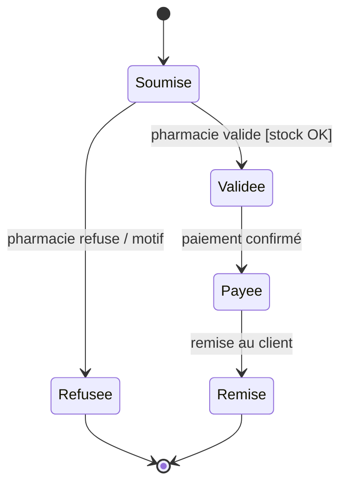
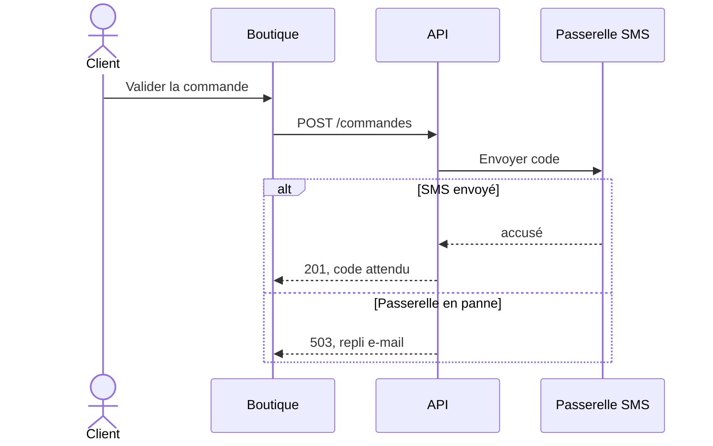
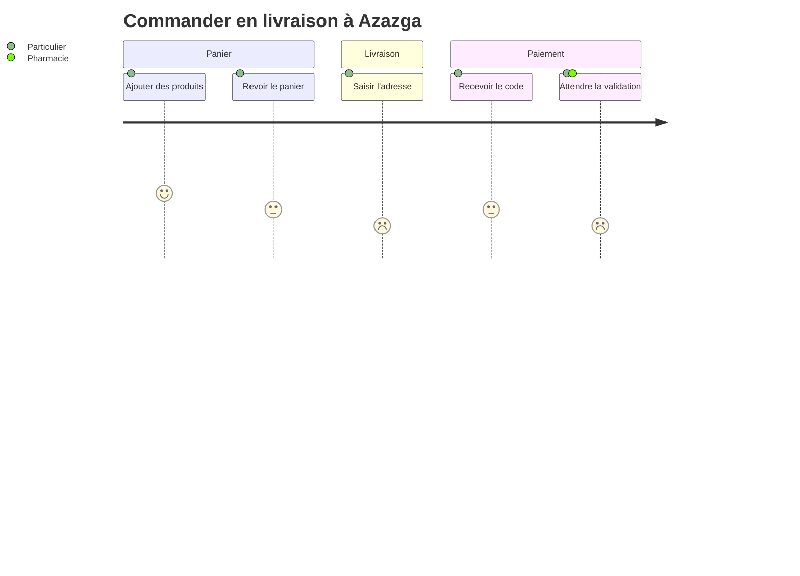
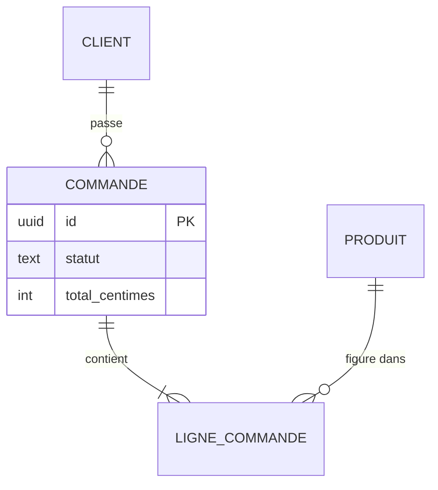
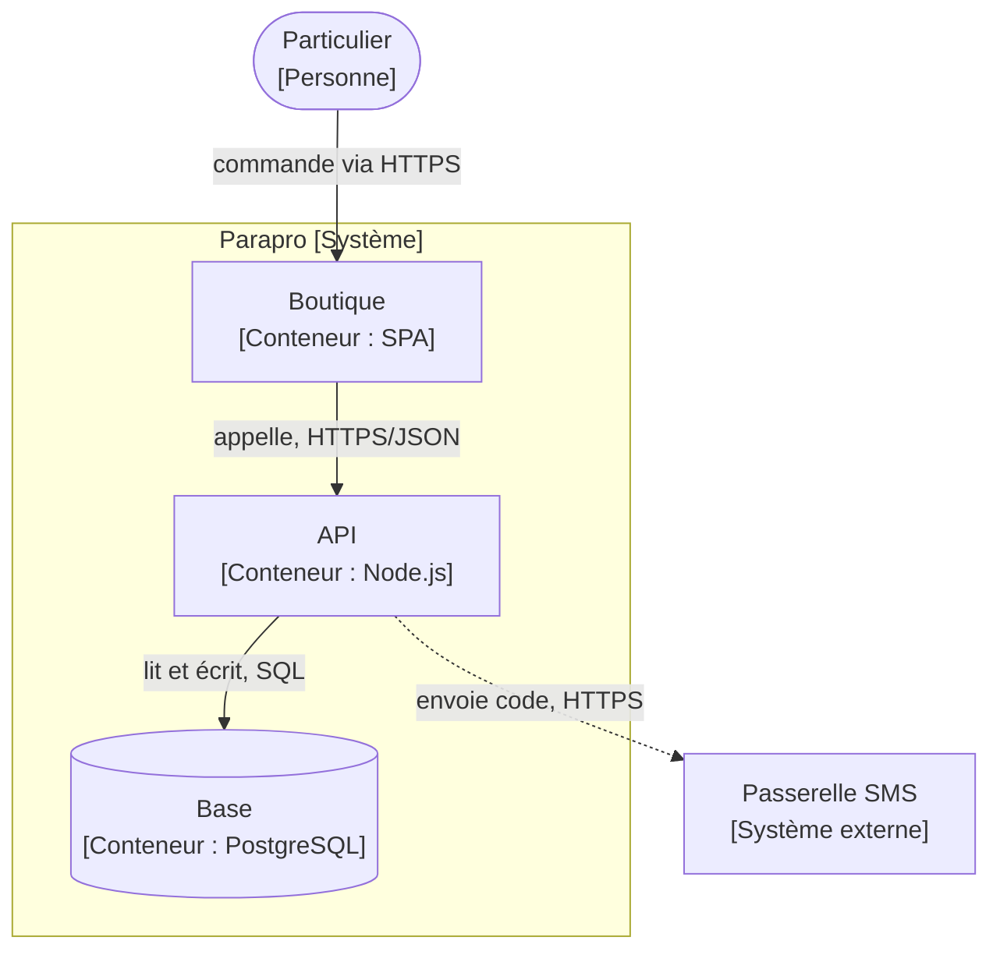

# Schémas Mermaid : états, séquences, parcours, BPMN léger, ER, C4, rendu hors ligne

Approfondit la section « Conventions de schéma » de `workflows-fonctionnels.md`. Sert au cartographe, au maquettiste et aux architectes. Lecture à la demande : la section du diagramme voulu seulement.

## Sommaire
1. Choisir le diagramme
2. Règles communes
3. Diagramme d'états
4. Diagramme de séquence
5. Parcours utilisateur
6. BPMN léger
7. Entités-relations
8. C4 en Mermaid
9. Rendu et validation hors ligne
10. Contrôles avant de rendre
11. Origine

## 1. Choisir le diagramme

| Question | Diagramme | Mot-clé |
|---|---|---|
| Par quels états passe un objet, et qu'est-ce qui est interdit ? | états | `stateDiagram-v2` |
| Qui appelle qui, dans quel ordre, avec quelles réponses et quels échecs ? | séquence | `sequenceDiagram` |
| Que vit l'utilisateur étape par étape, avec quelle satisfaction ? | parcours | `journey` |
| Quel processus métier traverse plusieurs acteurs ou services ? | BPMN léger | `flowchart LR` + `subgraph` |
| Quelles données et quelles cardinalités ? | entités-relations | `erDiagram` |
| Quels systèmes et conteneurs ? | C4 | `flowchart` structuré (section 8) |

## 2. Règles communes

- Un schéma répond à une question ; son titre la pose.
- Identifiants du projet dans les libellés (`EC-`, `WF-`, `RG-`, `FN-`) pour la traçabilité.
- Libellés courts entre guillemets s'ils contiennent des accents, parenthèses ou deux-points : `A["Valider (RG-2040)"]`.
- Quinze à vingt nœuds au plus ; au-delà, découper et relier par un renvoi.
- Pas de couleur porteuse de sens seule : doubler par une forme ou un libellé (accessibilité).
- Les chemins d'erreur figurent sur le schéma, pas seulement le chemin heureux.
- Le texte des schémas suit la langue du livrable ; les mots-clés Mermaid restent en anglais.

## 3. Diagramme d'états

À produire pour tout objet à cycle de vie (commande, paiement, livraison, compte pro).

Règles : chaque transition porte `événement [garde] / effet` ; tout état a une sortie ou est final ; les transitions interdites importantes s'écrivent dans le tableau du workflow (« Remise → Soumise : interdit ») ; les expirations sont des transitions explicites (`après 48 h`). Un état composite (`state Livraison { ... }`) regroupe des sous-états sans alourdir la vue principale. Vérifier que chaque état correspond à une valeur réelle de la base ou du code.

## 4. Diagramme de séquence

Règles : flèche pleine pour l'appel, pointillée pour la réponse ; `alt`/`else` pour les issues, `opt` pour l'optionnel, `loop` pour les relances, `par` pour le parallèle ; `Note over` pour un délai ou une règle ; numérotation `autonumber` si le texte du workflow renvoie aux étapes. Un participant par frontière réelle (navigateur, API, service tiers) ; la base n'apparaît que si l'ordre des écritures compte.

## 5. Parcours utilisateur

La note (1 à 5) est une hypothèse tant qu'elle ne vient pas d'un test d'utilisabilité ; l'écrire. Les étapes à note ≤ 2 renvoient à une recommandation ou à un écran à revoir.

## 6. BPMN léger

Mermaid n'a pas de BPMN natif. On en reprend les conventions de base dans un `flowchart LR`, un couloir par acteur. Pour un BPMN 2.0 complet (pools, flux de messages normés, échange avec un outil BPM), un fichier `.drawio` produit localement reste possible : `drawio/types-diagrammes.md` §1 (lot B du renfort externe).

| Élément BPMN | Rendu Mermaid | Règle |
|---|---|---|
| Couloir (acteur, service) | `subgraph PHA["Pharmacie"]` | un couloir par rôle, pas par personne |
| Événement de début / fin | `D(["Début : commande reçue"])` | un seul début par processus ; fin nommée par son résultat |
| Tâche | `T1["Préparer la commande"]` | verbe à l'infinitif + objet |
| Passerelle exclusive (une seule issue) | `G1{"Stock suffisant ?"}` | chaque sortie étiquetée ; issues mutuellement exclusives |
| Passerelle parallèle | `P1{{"+"}}` puis jointure `P2{{"+"}}` | toute ouverture parallèle se referme |
| Événement intermédiaire temporisé | `E1(["⏱ 48 h sans validation"])` | délai chiffré ou paramètre nommé |
| Flux de messages entre couloirs | `-.->` pointillé | réservé aux échanges entre acteurs ; séquence interne en trait plein |

Règles : lecture de gauche à droite ; pas de tâche sans entrée ni sortie ; chaque exception métier du workflow mène à une fin ou à une reprise explicite ; un processus de plus de vingt nœuds se découpe en sous-processus (`[["Sous-processus : paiement"]]`).

## 7. Entités-relations

Cardinalités : `||` exactement un, `o|` zéro ou un, `}|` un ou plusieurs, `}o` zéro ou plusieurs. Les noms suivent `donnees-schema.md` ; les montants en entiers (centimes) ; les attributs listés seulement s'ils servent la question du schéma. Le schéma est contrôlé contre les migrations, qui font foi.

## 8. C4 en Mermaid

Mermaid propose une syntaxe C4 expérimentale (`C4Context`, `C4Container`) dont la mise en page est peu contrôlable. Par défaut, dessiner les vues C4 en `flowchart` avec des conventions stables :

Chaque nœud porte nom, type entre crochets et technologie ; chaque flèche un verbe et un protocole ; la frontière du système en `subgraph` ; les systèmes externes hors du `subgraph`. Règles de contenu par niveau : `architecture-normes/references/c4-ddd-hexagonal.md`.

## 9. Rendu et validation hors ligne

- Le Markdown suffit : la plupart des éditeurs et forges affichent Mermaid sans service externe.
- Validation syntaxique locale, **facultative** : l'outil en ligne de commande de Mermaid (paquet npm `@mermaid-js/mermaid-cli`, commande `mmdc`) rend en SVG ou PNG, et une erreur de syntaxe fait échouer la commande. Son installation demande un accès réseau et télécharge probablement un navigateur sans interface (hypothèse, à vérifier). Elle se fait dans le projet, avec une version épinglée (version à vérifier à la source) et un fichier de verrouillage versionné, et seulement avec l'accord de l'utilisateur prévu au premier garde-fou de `usine-logicielle/SKILL.md` (section « Garde-fous », dépendance listée au compte rendu). Sans cet accord : mention « syntaxe non vérifiée ».
- **Interdit** : coller un schéma dans un éditeur en ligne ou un lien de partage qui encode le contenu dans l'URL (le contenu quitte le poste) ; polices ou icônes chargées depuis un CDN dans un rendu livré.
- draw.io de bureau fonctionne hors ligne pour les besoins hors Mermaid, mise à jour automatique coupée dans ses réglages (hypothèse sur l'emplacement du réglage, à vérifier selon la version) ; aucun script tiers n'est importé (`robustesse-agents/references/renfort-externe.md`).
- Un schéma non validé par rendu porte la mention « syntaxe non vérifiée ».

## 10. Contrôles avant de rendre

- Le diagramme choisi correspond à la question (section 1).
- Chemins d'erreur et transitions interdites présents.
- Identifiants du projet dans les libellés.
- Rendu local réussi, ou mention « syntaxe non vérifiée ».
- Aucun contenu envoyé vers un service en ligne.

## 11. Origine

Conventions reformulées en français pour Dan-Cortex ; aucun texte copié. Inspirées de :
- `ccheney/robust-skills` (MIT), skill `mermaid-diagrams` (références `STATE-JOURNEY.md`, `SEQUENCE.md`, `CLASS-ER.md`, `ARCHITECTURE.md`) — https://github.com/ccheney/robust-skills, commit `0eea7b0`.
- `softaworks/agent-toolkit` (MIT), skills `mermaid-diagrams` et `c4-architecture` — https://github.com/softaworks/agent-toolkit, commit `3027f20`.
- Conventions BPMN de base : `Agents365-ai/drawio-skill` (MIT, © 2026 Agents365-ai), `references/diagram-types.md` et `shapes.md`, idées seulement, aucun script — https://github.com/Agents365-ai/drawio-skill, commit `1f59eae`.
- Détail : `sources/renfort-github.md`. Décision d'origine : réunion « renfort GitHub » du 2026-11-03 (projet Parapro, DEC-042).
