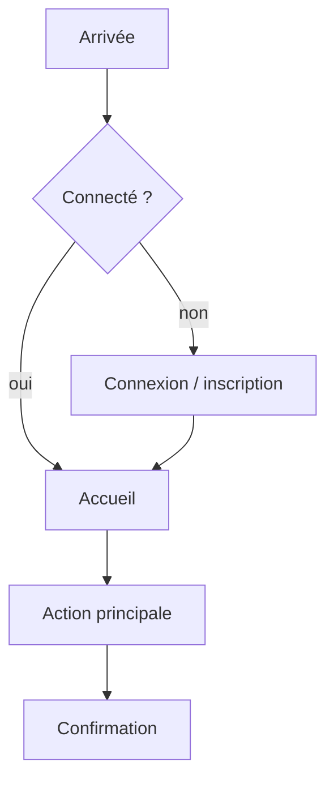
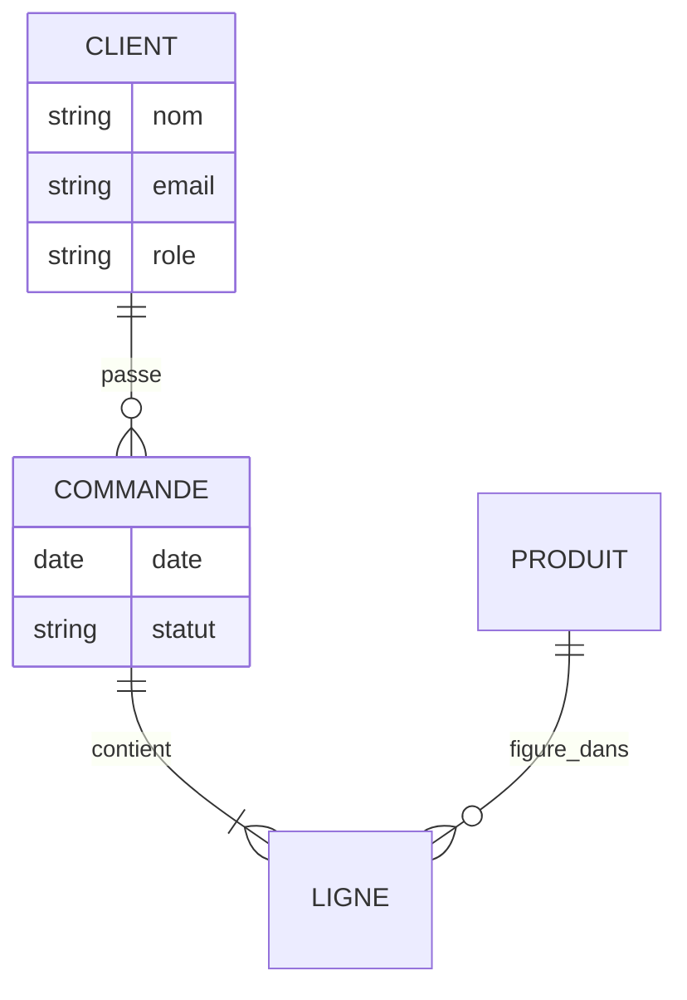
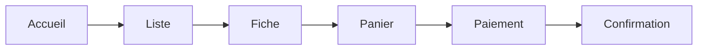
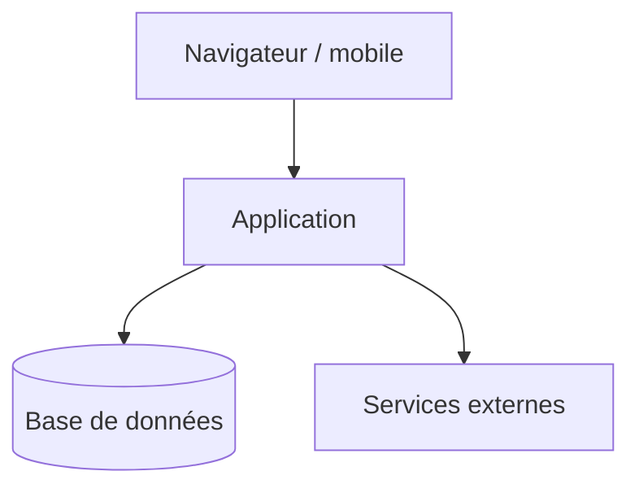

# Schémas en Mermaid (texte rendu ensuite)

Mermaid (MIT) écrit des diagrammes en texte, versionnables, rendus en image. On produit le texte ; le rendu se fait avec `mmdc` (déjà présent dans l'environnement) ou un aperçu. Pour des schémas plus riches à éditer à la main : draw.io (Apache-2.0) ; pour des wireframes peu intimidants : Excalidraw (MIT) ; pour des maquettes fidèles : Penpot (MPL-2.0).

## Parcours utilisateur (flowchart)

## Modèle de données (entité-association)

## Enchaînement des écrans

## Architecture (blocs)

Règles : un schéma répond à une question (parcours, données, écrans, architecture) ; on le montre à la personne et on le fait valider ; on garde le texte source dans le dossier pour pouvoir le modifier.
