# Documentation de Dan-Cortex

Point d'entrée de la documentation : par où commencer selon ce que tu veux faire.

## Parcours de lecture

| Tu veux… | Lis, dans cet ordre |
|---|---|
| **Installer et lancer un premier projet** | [Guide de démarrage](guide-demarrage.md) → [FAQ](faq.md) |
| **Comprendre comment le réseau travaille** | [Architecture](architecture.md) (§1 à §8) → [Catalogue des agents](catalogue-agents.md) |
| **Trouver la bonne compétence** | [Catalogue des skills](catalogue-skills.md) → [Bibliothèque à la demande](bibliotheque.md) |
| **Évaluer la sécurité** | [Sécurité et robustesse](securite-et-robustesse.md) → [`SECURITY.md`](../SECURITY.md) |
| **Contribuer ou modifier un skill** | [`CONTRIBUTING.md`](../CONTRIBUTING.md) → [Architecture](architecture.md) §9 à §11 → [Audit du dépôt](audit-depot.md) |
| **Utiliser Dan-Cortex avec une autre IA** | [`AGENTS.md`](../AGENTS.md) → [paquet universel](../dan-cortex/universel/INSTALLATION.md) |
| **Vérifier d'où vient la méthode** | [Rapport d'expertise](expertise.md) → [Essai à blanc](essai-a-blanc.md) → [`NOTICE.md`](../dan-cortex/NOTICE.md) |

## Tous les documents

| Document | Contenu | Écrit à la main ou généré |
|---|---|---|
| [guide-demarrage.md](guide-demarrage.md) | installation, premier projet, modes, reprise | main |
| [architecture.md](architecture.md) | pôles, chef d'orchestre, agents, jalons, registres, contrôles, scripts, dépôt, bibliothèque | main |
| [bibliotheque.md](bibliotheque.md) | compétences tierces chargées à la demande, garde-fous, ajout d'une source | main |
| [catalogue-skills.md](catalogue-skills.md) | liste des skills par famille | **généré** par `scripts/generer_catalogues.py` |
| [catalogue-agents.md](catalogue-agents.md) | liste des agents par pôle | **généré** par `scripts/generer_catalogues.py` |
| [securite-et-robustesse.md](securite-et-robustesse.md) | limites dures, injection d'instructions, confidentialité, scripts tiers | main |
| [faq.md](faq.md) | questions fréquentes | main |
| [expertise.md](expertise.md) | état de l'art et sources de la méthode | main |
| [essai-a-blanc.md](essai-a-blanc.md) | essai réel du jalon J1 | main |
| [audit-depot.md](audit-depot.md) | audit de l'organisation du dépôt et plan d'action | main |
| [audit-coherence-2026-11-22.md](audit-coherence-2026-11-22.md) | audit de cohérence : versions, compteurs, renvois, fiches d'agents, licences | main |

## Schémas

Les schémas sont des SVG lisibles par les lecteurs d'écran (titre et description). Les schémas animés restent
immobiles si ton système demande de réduire les animations.

| Schéma | Montre | Origine |
|---|---|---|
| [carte-depot.svg](images/carte-depot.svg) | chaque dossier du dépôt, sources et fichiers générés | main |
| [chaine-generation.svg](images/chaine-generation.svg) | de la modification à l'installation, contrôles de la CI (animé) | main |
| [chargement-a-la-demande.svg](images/chargement-a-la-demande.svg) | comment un pivot ouvre une seule compétence de la bibliothèque (animé) | main |
| [carte-poles.svg](images/carte-poles.svg) | les pôles et leurs agents | **généré** |
| [carte-skills.svg](images/carte-skills.svg) | les skills par famille | **généré** |
| [jalons.svg](images/jalons.svg) | les jalons J0 à J7 | main |
| [vague-agents.svg](images/vague-agents.svg) | une vague d'agents en parallèle | main |
| [cycle-reunion.svg](images/cycle-reunion.svg) | une réunion de décision | main |
| [banniere.svg](images/banniere.svg) | bannière du README | main |
