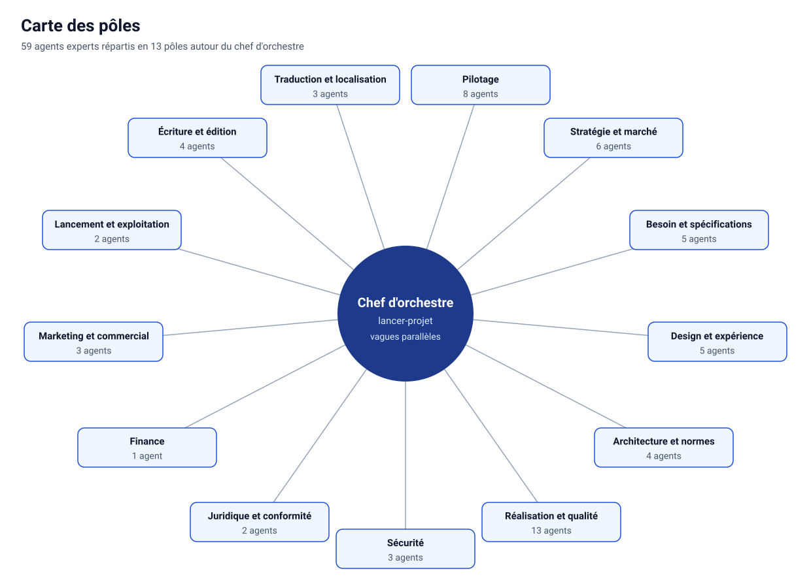

<!-- Fichier généré par scripts/generer_catalogues.py : ne pas modifier à la main. -->

# Catalogue des agents

59 agents experts, rangés par pôle selon l'[organigramme du réseau](../dan-cortex/skills/lancer-projet/references/organigramme.md). Type d'agent à lancer : `dan-cortex:<nom>`. Fiches complètes dans [`dan-cortex/agents/`](../dan-cortex/agents/).

| Niveau | Modèle | Rôle | Agents |
|---|---|---|---:|
| A — jugement | celui de la session (`inherit`) | arbitrer, concevoir, auditer | 6 |
| B — production | `sonnet` | analyser, rédiger, développer, tester | 49 |
| C — collecte | `haiku` | collecter, exécuter, vérifier une liste | 4 |

## Sommaire

- [Pilotage](#pilotage) (8)
- [Stratégie et marché](#stratégie-et-marché) (6)
- [Besoin et spécifications](#besoin-et-spécifications) (5)
- [Design et expérience](#design-et-expérience) (5)
- [Architecture et normes](#architecture-et-normes) (4)
- [Réalisation et qualité](#réalisation-et-qualité) (13)
- [Sécurité](#sécurité) (3)
- [Juridique et conformité](#juridique-et-conformité) (2)
- [Finance](#finance) (1)
- [Marketing et commercial](#marketing-et-commercial) (3)
- [Lancement et exploitation](#lancement-et-exploitation) (2)
- [Écriture et édition](#écriture-et-édition) (4)
- [Traduction et localisation](#traduction-et-localisation) (3)

## Pilotage

| Agent | Mission | Niveau | Effort | Outils | Skills préchargés |
|---|---|---|---|---|---|
| [`auditeur-general`](../dan-cortex/agents/auditeur-general.md) | super-auditeur indépendant : audit à 360° et recontrôle. | A — jugement | high | Read, Glob, Grep, Bash, Write | `audit-general` |
| [`contradicteur`](../dan-cortex/agents/contradicteur.md) | contradicteur : objections, pré-mortem, angles morts. | B — production | medium | Read, Write, Edit, Glob, Grep, WebSearch, WebFetch | `reunion-decision` |
| [`orchestrateur-de-pole`](../dan-cortex/agents/orchestrateur-de-pole.md) | orchestrateur de pôle : plan de délégation et consolidation. | B — production | medium | Read, Write, Glob, Grep, Agent | — |
| [`planificateur`](../dan-cortex/agents/planificateur.md) | planificateur : découpage, planning, RACI, risques, lots. | B — production | medium | Read, Write, Edit, Glob, Grep, Bash | `cartographie-graphe` |
| [`rapporteur`](../dan-cortex/agents/rapporteur.md) | rapporteur de réunion : dossier de séance, synthèse, procès-verbal. | B — production | medium | Read, Write, Edit, Glob, Grep | `reunion-decision` |
| [`suivi-avancement`](../dan-cortex/agents/suivi-avancement.md) | suivi d'avancement : barres de progression et état de chaque étape, à partir de preuves comptables. | C — collecte | low | Read, Glob, Grep, Bash, Write | — |
| [`verificateur`](../dan-cortex/agents/verificateur.md) | vérificateur : contrôle d'un livrable contre une liste de critères. | C — collecte | low | Read, Glob, Grep, Bash, Write | — |
| [`vigie-oublis`](../dan-cortex/agents/vigie-oublis.md) | vigie indépendante, jamais distraite : oublis (engagements, promesses, preuves rejouées) et conformité à la méthode et aux normes (plan, spécification, test … | A — jugement | high | Read, Glob, Grep, Bash, Write | `audit-general`, `cartographie-graphe` |

## Stratégie et marché

| Agent | Mission | Niveau | Effort | Outils | Skills préchargés |
|---|---|---|---|---|---|
| [`analyste-concurrence`](../dan-cortex/agents/analyste-concurrence.md) | analyste concurrence : benchmark, matrice fonctionnelle, prix, positionnements. | B — production | medium | Read, Write, Edit, Glob, Grep, WebSearch, WebFetch | `veille-marche` |
| [`analyste-contexte`](../dan-cortex/agents/analyste-contexte.md) | analyste contexte : facteurs politiques, économiques, sociaux, culturels par pays. | B — production | medium | Read, Write, Edit, Glob, Grep, WebSearch, WebFetch | `veille-marche` |
| [`analyste-marche`](../dan-cortex/agents/analyste-marche.md) | analyste marché : taille du marché en deux méthodes, segments, tendances. | B — production | medium | Read, Write, Edit, Glob, Grep, WebSearch, WebFetch | `veille-marche` |
| [`analyste-voix-client`](../dan-cortex/agents/analyste-voix-client.md) | analyste voix du client : irritants, attentes et manques tirés des avis. | B — production | medium | Read, Write, Edit, Glob, Grep, WebSearch, WebFetch | `veille-marche` |
| [`collecteur-web`](../dan-cortex/agents/collecteur-web.md) | collecteur web : une fiche de faits sourcée par concurrent ou par source. | C — collecte | low | Read, Write, Edit, Glob, Grep, WebSearch, WebFetch | `veille-marche` |
| [`stratege-produit`](../dan-cortex/agents/stratege-produit.md) | stratège produit : positionnement, écarts, périmètre et note d'opportunité. | A — jugement | high | Read, Write, Edit, Glob, Grep | `veille-marche` |

## Besoin et spécifications

| Agent | Mission | Niveau | Effort | Outils | Skills préchargés |
|---|---|---|---|---|---|
| [`expert-cahier-des-charges`](../dan-cortex/agents/expert-cahier-des-charges.md) | expert cahier des charges : note de cadrage, exigences EX- et EXNF-. | B — production | medium | Read, Write, Edit, Glob, Grep, Bash | `specifications` |
| [`intervieweur`](../dan-cortex/agents/intervieweur.md) | intervieweur : recueille le besoin d'une personne par un entretien adapté à son profil, du brut au cahier des charges. | B — production | medium | Read, Write, Edit, Glob, Grep | `recueil-besoin`, `specifications` |
| [`redacteur-sfd`](../dan-cortex/agents/redacteur-sfd.md) | rédacteur SFD : règles RG-, cas nominaux et d'exception d'un module. | B — production | medium | Read, Write, Edit, Glob, Grep, Bash | `specifications` |
| [`redacteur-sfg`](../dan-cortex/agents/redacteur-sfg.md) | rédacteur SFG : acteurs, fonctions FN-, processus, objets métier. | B — production | medium | Read, Write, Edit, Glob, Grep, Bash | `specifications` |
| [`redacteur-specs-techniques`](../dan-cortex/agents/redacteur-specs-techniques.md) | rédacteur specs techniques : contrats d'interface, traitements, formats. | B — production | medium | Read, Write, Edit, Glob, Grep, Bash | `specifications` |

## Design et expérience

| Agent | Mission | Niveau | Effort | Outils | Skills préchargés |
|---|---|---|---|---|---|
| [`cartographe-interactions`](../dan-cortex/agents/cartographe-interactions.md) | cartographe des interactions : workflows et matrice écran-action-destination. | B — production | medium | Read, Write, Edit, Glob, Grep, Bash | `maquettes-parcours` |
| [`concepteur-ux`](../dan-cortex/agents/concepteur-ux.md) | concepteur UX : personas, parcours cibles et architecture de l'information. | B — production | medium | Read, Write, Edit, Glob, Grep, WebSearch, WebFetch | `maquettes-parcours`, `design-apple`, `mouvement-interface` |
| [`expert-accessibilite`](../dan-cortex/agents/expert-accessibilite.md) | expert accessibilité : exigences WCAG 2.2 AA, RGAA et audit du produit. | B — production | medium | Read, Write, Edit, Glob, Grep, Bash, WebSearch, WebFetch | `maquettes-parcours`, `design-apple`, `mouvement-interface` |
| [`maquettiste`](../dan-cortex/agents/maquettiste.md) | maquettiste : maquettes HTML ou SVG autonomes, thème et système de design. | B — production | medium | Read, Write, Edit, Glob, Grep, Bash | `maquettes-parcours`, `design-apple`, `mouvement-interface` |
| [`redacteur-contenu-localisation`](../dan-cortex/agents/redacteur-contenu-localisation.md) | rédacteur contenu : microcopie, traduction, adaptation culturelle. | B — production | medium | Read, Write, Edit, Glob, Grep, WebSearch, WebFetch | `maquettes-parcours` |

## Architecture et normes

| Agent | Mission | Niveau | Effort | Outils | Skills préchargés |
|---|---|---|---|---|---|
| [`architecte-donnees`](../dan-cortex/agents/architecte-donnees.md) | architecte des données : schéma, migrations, gouvernance, isolation. | B — production | medium | Read, Write, Edit, Glob, Grep, Bash | `architecture-normes`, `cartographie-graphe`, `crm-twenty` |
| [`architecte-solution`](../dan-cortex/agents/architecte-solution.md) | architecte de solution : choix techniques tracés, dossier d'architecture. | A — jugement | high | Read, Write, Edit, Glob, Grep, Bash, WebSearch, WebFetch | `architecture-normes`, `cartographie-graphe`, `crm-twenty` |
| [`gardien-des-normes`](../dan-cortex/agents/gardien-des-normes.md) | gardien des normes : référentiel de code, outils de contrôle, écarts. | B — production | medium | Read, Write, Edit, Glob, Grep, Bash, WebSearch, WebFetch | `architecture-normes`, `usine-logicielle` |
| [`ingenieur-devops`](../dan-cortex/agents/ingenieur-devops.md) | ingénieur DevOps : hébergement, environnements, CI/CD, supervision. | B — production | medium | Read, Write, Edit, Glob, Grep, Bash, WebSearch, WebFetch | `architecture-normes`, `lancement-exploitation`, `crm-twenty` |

## Réalisation et qualité

| Agent | Mission | Niveau | Effort | Outils | Skills préchargés |
|---|---|---|---|---|---|
| [`automaticien-tests`](../dan-cortex/agents/automaticien-tests.md) | automaticien de tests : tests d'API, de bout en bout et de performance. | B — production | medium | Read, Write, Edit, Glob, Grep, Bash, WebFetch | `usine-logicielle` |
| [`concepteur-tests`](../dan-cortex/agents/concepteur-tests.md) | concepteur de tests : stratégie de test, cahier de recette tracé. | B — production | medium | Read, Write, Edit, Glob, Grep, Bash | `usine-logicielle` |
| [`developpeur-backend`](../dan-cortex/agents/developpeur-backend.md) | développeur serveur : lot backend, tests unitaires puis code, en local. | B — production | medium | Read, Write, Edit, Glob, Grep, Bash, WebFetch | `usine-logicielle`, `cartographie-graphe`, `crm-twenty` |
| [`developpeur-frontend`](../dan-cortex/agents/developpeur-frontend.md) | développeur interface web : lot frontend, états d'écran, accessibilité. | B — production | medium | Read, Write, Edit, Glob, Grep, Bash, WebFetch | `usine-logicielle`, `design-apple`, `cartographie-graphe`, `mouvement-interface` |
| [`developpeur-mobile`](../dan-cortex/agents/developpeur-mobile.md) | développeur mobile : lot application, stores, hors-ligne, permissions. | B — production | medium | Read, Write, Edit, Glob, Grep, Bash, WebFetch | `usine-logicielle`, `design-apple`, `cartographie-graphe`, `mouvement-interface` |
| [`executant-tests`](../dan-cortex/agents/executant-tests.md) | exécutant de tests : lance les suites et rapporte les seuls échecs. | C — collecte | low | Read, Glob, Grep, Bash, Write | `usine-logicielle` |
| [`integrateur`](../dan-cortex/agents/integrateur.md) | intégrateur : paramétrage de progiciel, intégrations, reprise de données. | B — production | medium | Read, Write, Edit, Glob, Grep, Bash, WebFetch | `usine-logicielle`, `crm-twenty` |
| [`organisateur`](../dan-cortex/agents/organisateur.md) | organisateur : tient la carte des fonctionnalités, le carnet de demandes et le plan de vagues de test ; attribue chaque tâche à un lot et à un responsable  … | B — production | medium | Read, Write, Edit, Glob, Grep, Bash | `usine-logicielle`, `cartographie-graphe` |
| [`recetteur`](../dan-cortex/agents/recetteur.md) | recetteur indépendant : campagne de recette, anomalies, PV. | B — production | medium | Read, Write, Edit, Glob, Grep, Bash, WebFetch | `usine-logicielle` |
| [`relecteur-code`](../dan-cortex/agents/relecteur-code.md) | relecteur de code : revue indépendante des différences d'un lot. | B — production | medium | Read, Write, Edit, Glob, Grep, Bash, WebFetch | `usine-logicielle`, `cartographie-graphe`, `design-apple` |
| [`testeur-mobile`](../dan-cortex/agents/testeur-mobile.md) | testeur mobile expert : appareils, thème sombre, tactile, RTL, réseau lent, ergonomie e-commerce mobile. | B — production | medium | Read, Write, Edit, Glob, Grep, Bash, WebFetch | `usine-logicielle`, `maquettes-parcours`, `design-apple`, `mouvement-interface` |
| [`testeur-visuel`](../dan-cortex/agents/testeur-visuel.md) | testeur visuel : capture chaque écran et état, le compare à sa maquette et à sa référence, et rend un verdict bloquant sur les écarts de mise en page, de … | B — production | medium | Read, Glob, Grep, Bash, Write | `design-apple`, `mouvement-interface` |
| [`testeur-web`](../dan-cortex/agents/testeur-web.md) | testeur web et UX expert : conformité aux maquettes, multi-navigateurs, heuristiques, accessibilité clavier, régression visuelle. | B — production | medium | Read, Write, Edit, Glob, Grep, Bash, WebFetch | `usine-logicielle`, `maquettes-parcours`, `design-apple`, `mouvement-interface` |

## Sécurité

| Agent | Mission | Niveau | Effort | Outils | Skills préchargés |
|---|---|---|---|---|---|
| [`architecte-securite`](../dan-cortex/agents/architecte-securite.md) | architecte sécurité : risques, menaces, protections et réponse à incident. | A — jugement | high | Read, Write, Edit, Glob, Grep, Bash, WebSearch, WebFetch | `safety`, `securite-protection`, `crm-twenty` |
| [`auditeur-securite`](../dan-cortex/agents/auditeur-securite.md) | auditeur sécurité : tests complets du code, des dépendances et de l'application. | B — production | medium | Read, Write, Edit, Glob, Grep, Bash, WebSearch, WebFetch | `safety`, `securite-protection`, `robustesse-agents`, `cartographie-graphe`, `crm-twenty` |
| [`testeur-intrusion`](../dan-cortex/agents/testeur-intrusion.md) | testeur d'intrusion : test autorisé sur le périmètre du projet, rapport, contre-test. | B — production | medium | Read, Write, Edit, Glob, Grep, Bash, WebSearch, WebFetch | `safety`, `securite-protection`, `cartographie-graphe` |

## Juridique et conformité

| Agent | Mission | Niveau | Effort | Outils | Skills préchargés |
|---|---|---|---|---|---|
| [`delegue-protection-donnees`](../dan-cortex/agents/delegue-protection-donnees.md) | délégué données : registre, bases légales, AIPD, cookies, IA. | B — production | medium | Read, Write, Edit, Glob, Grep, WebSearch, WebFetch | `juridique-conformite`, `crm-twenty` |
| [`juriste-numerique`](../dan-cortex/agents/juriste-numerique.md) | juriste du numérique : conformité, contrats, pénal, fiscalité, documents. | A — jugement | high | Read, Write, Edit, Glob, Grep, WebSearch, WebFetch | `juridique-conformite`, `crm-twenty` |

## Finance

| Agent | Mission | Niveau | Effort | Outils | Skills préchargés |
|---|---|---|---|---|---|
| [`controleur-financier`](../dan-cortex/agents/controleur-financier.md) | contrôleur financier : estimation, budget sur trois ans, économie du projet. | B — production | medium | Read, Write, Edit, Glob, Grep, Bash, WebSearch, WebFetch | `budget-finance` |

## Marketing et commercial

| Agent | Mission | Niveau | Effort | Outils | Skills préchargés |
|---|---|---|---|---|---|
| [`expert-acquisition`](../dan-cortex/agents/expert-acquisition.md) | expert acquisition : canaux, référencement, stores, publicité, e-mail, marquage. | B — production | medium | Read, Write, Edit, Glob, Grep, WebSearch, WebFetch | `marketing-commercial` |
| [`responsable-commercial`](../dan-cortex/agents/responsable-commercial.md) | responsable commercial : offre et prix, processus de vente, partenaires, rétention. | B — production | medium | Read, Write, Edit, Glob, Grep, WebSearch, WebFetch | `marketing-commercial`, `crm-twenty` |
| [`stratege-marketing`](../dan-cortex/agents/stratege-marketing.md) | stratège marketing : stratégie de marché, marque, plan marketing et de lancement. | B — production | medium | Read, Write, Edit, Glob, Grep, WebSearch, WebFetch | `marketing-commercial` |

## Lancement et exploitation

| Agent | Mission | Niveau | Effort | Outils | Skills préchargés |
|---|---|---|---|---|---|
| [`responsable-lancement`](../dan-cortex/agents/responsable-lancement.md) | responsable du lancement : go/no-go, plan de bascule, retour arrière, bilan. | B — production | medium | Read, Write, Edit, Glob, Grep, Bash, WebSearch, WebFetch | `lancement-exploitation` |
| [`responsable-support-formation`](../dan-cortex/agents/responsable-support-formation.md) | responsable support et formation : plan de support, documentation, formation, changement. | B — production | medium | Read, Write, Edit, Glob, Grep, WebSearch, WebFetch | `lancement-exploitation` |

## Écriture et édition

| Agent | Mission | Niveau | Effort | Outils | Skills préchargés |
|---|---|---|---|---|---|
| [`architecte-recit`](../dan-cortex/agents/architecte-recit.md) | architecte de récit : structure, plan, arcs et cohérence d'un livre ou d'un roman. | B — production | medium | Read, Write, Edit, Glob, Grep | `atelier-ecriture` |
| [`concepteur-univers`](../dan-cortex/agents/concepteur-univers.md) | concepteur d'univers : personnages, monde et continuité d'une œuvre. | B — production | medium | Read, Write, Edit, Glob, Grep | `atelier-ecriture` |
| [`editeur-litteraire`](../dan-cortex/agents/editeur-litteraire.md) | éditeur littéraire : les quatre passes d'édition, relecture bêta et continuité. | B — production | medium | Read, Write, Edit, Glob, Grep, Bash | `atelier-ecriture` |
| [`plume`](../dan-cortex/agents/plume.md) | plume : rédige scènes et chapitres dans la voix et le point de vue choisis. | B — production | medium | Read, Write, Edit, Glob, Grep | `atelier-ecriture` |

## Traduction et localisation

| Agent | Mission | Niveau | Effort | Outils | Skills préchargés |
|---|---|---|---|---|---|
| [`interprete`](../dan-cortex/agents/interprete.md) | interprète : prépare et cadre l'interprétation orale (consécutif, simultané, liaison), FR/AR/EN. | B — production | medium | Read, Write, Edit, Glob, Grep | `traduction-interpretariat` |
| [`localisateur`](../dan-cortex/agents/localisateur.md) | localisateur : internationalise et localise un produit (RTL, formats, PO/XLIFF, mémoires de traduction), avec outils libres. | B — production | medium | Read, Write, Edit, Glob, Grep, Bash | `traduction-interpretariat`, `usine-logicielle` |
| [`traducteur`](../dan-cortex/agents/traducteur.md) | traducteur : traduit un texte ou une œuvre (FR/AR/EN) en gardant sens, registre et intention, puis révise. | B — production | medium | Read, Write, Edit, Glob, Grep, Bash, WebSearch, WebFetch | `traduction-interpretariat` |
