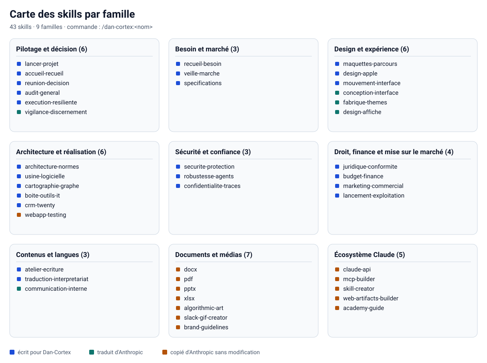

<!-- Fichier généré par scripts/generer_catalogues.py : ne pas modifier à la main. -->

# Catalogue des skills

43 skills, rangés en 9 familles. Chaque skill s'appelle par `/dan-cortex:<nom>` dans Claude Code ou dans l'application Claude. Les descriptions sont celles des fichiers `SKILL.md` (celles des skills copiés d'Anthropic sont restées en anglais).

Origines : 25 écrits pour Dan-Cortex, 5 traduits d'Anthropic, 13 copiés d'Anthropic sans modification (licence Apache-2.0, voir [`dan-cortex/NOTICE.md`](../dan-cortex/NOTICE.md)).

## Sommaire

- [Pilotage et décision](#pilotage-et-décision) (6)
- [Besoin et marché](#besoin-et-marché) (3)
- [Design et expérience](#design-et-expérience) (6)
- [Architecture et réalisation](#architecture-et-réalisation) (6)
- [Sécurité et confiance](#sécurité-et-confiance) (3)
- [Droit, finance et mise sur le marché](#droit-finance-et-mise-sur-le-marché) (4)
- [Contenus et langues](#contenus-et-langues) (3)
- [Documents et médias](#documents-et-médias) (7)
- [Écosystème Claude](#écosystème-claude) (5)

## Pilotage et décision

| Commande | Rôle | Origine | Références | Scripts |
|---|---|---|---:|---:|
| [`/dan-cortex:lancer-projet`](../dan-cortex/skills/lancer-projet/SKILL.md) | Chef d'orchestre Dan-Cortex : cadre, conçoit, fait réaliser, tester, sécuriser et lancer un projet numérique de bout en bout avec un réseau d'agents experts en parallèle (marché, cahier des charges, spécifications, maquettes … | Dan-Cortex | 24 | 2 |
| [`/dan-cortex:accueil-recueil`](../dan-cortex/skills/accueil-recueil/SKILL.md) | Premier contact Dan-Cortex : accueille l'utilisateur, recueille son besoin même brut et désordonné, le reformule et le fait valider, lance l'exploration du domaine (web et GitHub), revient avec des propositions, mène l'entretien … | Dan-Cortex | 7 | 0 |
| [`/dan-cortex:reunion-decision`](../dan-cortex/skills/reunion-decision/SKILL.md) | Réunion entre agents experts Dan-Cortex : positions séparées, débat contradictoire, arbitrage, décision tracée. À utiliser pour trancher un choix structurant (positionnement, périmètre, architecture, budget, go/no-go), départager … | Dan-Cortex | 2 | 0 |
| [`/dan-cortex:audit-general`](../dan-cortex/skills/audit-general/SKILL.md) | Audit général Dan-Cortex : un super-auditeur indépendant passe le projet en revue à 360°, son rapport est débattu en plénière, puis les corrections sont décidées et recontrôlées. À utiliser avant un lancement, à un jalon, ou pour … | Dan-Cortex | 2 | 0 |
| [`/dan-cortex:execution-resiliente`](../dan-cortex/skills/execution-resiliente/SKILL.md) | Mode d'exécution autonome et résiliente pour tout type de projet : transforme une demande en livrable vérifié, exploite les outils et agents disponibles, diagnostique les blocages, récupère après les erreurs et poursuit les … | Dan-Cortex | 0 | 0 |
| [`/dan-cortex:vigilance-discernement`](../dan-cortex/skills/vigilance-discernement/SKILL.md) | Invitation à la vigilance après une réponse ou un livrable substantiel sur lequel l'utilisateur va agir (conseil, plan, estimation, analyse de données, affirmation factuelle) : deux ou trois questions de suivi précises pour … | traduit d'Anthropic (Apache-2.0) | 0 | 0 |

## Besoin et marché

| Commande | Rôle | Origine | Références | Scripts |
|---|---|---|---:|---:|
| [`/dan-cortex:recueil-besoin`](../dan-cortex/skills/recueil-besoin/SKILL.md) | Recueil du besoin par interview, du brut au cahier des charges. Dan-Cortex interroge une personne — même sans aucune notion d'informatique, de code ou de gestion de projet — pour transformer un besoin mal formulé en un cahier des … | Dan-Cortex | 5 | 0 |
| [`/dan-cortex:veille-marche`](../dan-cortex/skills/veille-marche/SKILL.md) | Pôle Stratégie et marché de Dan-Cortex : taille du marché, démontage des concurrents, voix du client, contexte politique, économique et culturel, puis décision. À utiliser pour étude de marché, benchmark, avis clients, « que … | Dan-Cortex | 9 | 0 |
| [`/dan-cortex:specifications`](../dan-cortex/skills/specifications/SKILL.md) | Pôle Besoin et spécifications de Dan-Cortex : note de cadrage, cahier des charges (EX-, EXNF-), spécifications générales (FN-), détaillées (RG-) et techniques. À utiliser pour « rédige le cahier des charges », « exigences », « … | Dan-Cortex | 11 | 0 |

## Design et expérience

| Commande | Rôle | Origine | Références | Scripts |
|---|---|---|---:|---:|
| [`/dan-cortex:maquettes-parcours`](../dan-cortex/skills/maquettes-parcours/SKILL.md) | Pôle Design de Dan-Cortex : workflow schématisé de chaque fonctionnalité, matrice d'interactions (chaque écran, bouton, clic, réaction, destination), maquettes, thème, accessibilité, localisation. À utiliser pour des maquettes … | Dan-Cortex | 26 | 0 |
| [`/dan-cortex:design-apple`](../dan-cortex/skills/design-apple/SKILL.md) | Design de niveau Apple pour le web et le mobile : principes des Human Interface Guidelines appliqués (clarté, hiérarchie, retenue, profondeur), échelle typographique, grille de 4/8 px, rayons, matières translucides, ombres … | Dan-Cortex | 2 | 0 |
| [`/dan-cortex:mouvement-interface`](../dan-cortex/skills/mouvement-interface/SKILL.md) | Mouvement des interfaces web et mobiles : décider s'il faut animer, construire une animation (outil, propriétés, courbe, durée, ressort), chorégraphier plusieurs éléments, rendre un geste fluide (interruption, vitesse, inertie … | Dan-Cortex | 7 | 0 |
| [`/dan-cortex:conception-interface`](../dan-cortex/skills/conception-interface/SKILL.md) | Direction visuelle d'une interface web ou mobile qui ne ressemble pas à un gabarit par défaut : sujet, palette, typographie, composition, mouvement, rédaction de l'interface, plan de design puis critique avant de coder. À … | traduit d'Anthropic (Apache-2.0) | 0 | 0 |
| [`/dan-cortex:fabrique-themes`](../dan-cortex/skills/fabrique-themes/SKILL.md) | Habillage cohérent d'un livrable (présentation, document, rapport, page HTML) avec un thème de couleurs et de polices : dix thèmes prêts à l'emploi et création d'un thème sur mesure. À utiliser pour « applique un thème à ce … | traduit d'Anthropic (Apache-2.0) | 0 | 0 |
| [`/dan-cortex:design-affiche`](../dan-cortex/skills/design-affiche/SKILL.md) | Création d'une pièce visuelle statique originale (affiche, visuel d'art, couverture, planche) en PNG ou PDF à partir d'une philosophie de design rédigée d'abord, puis exprimée sur un canevas : forme, espace, couleur, composition … | traduit d'Anthropic (Apache-2.0) | 0 | 0 |

## Architecture et réalisation

| Commande | Rôle | Origine | Références | Scripts |
|---|---|---|---:|---:|
| [`/dan-cortex:architecture-normes`](../dan-cortex/skills/architecture-normes/SKILL.md) | Pôle Architecture et normes de Dan-Cortex : choix tracés du langage, des frameworks, de la base de données, de la structure et des outils ; schéma de données ; normes de code ; infrastructure. À utiliser pour « quelle techno … | Dan-Cortex | 28 | 0 |
| [`/dan-cortex:usine-logicielle`](../dan-cortex/skills/usine-logicielle/SKILL.md) | Pôle Réalisation et qualité de Dan-Cortex : construit le code lot par lot en autonomie, puis enchaîne tests unitaires, fonctionnels, d'API, de bout en bout, recette, sécurité et intrusion, avec corrections. À utiliser pour coder … | Dan-Cortex | 31 | 0 |
| [`/dan-cortex:cartographie-graphe`](../dan-cortex/skills/cartographie-graphe/SKILL.md) | Cartographie du code en graphe de connaissances avec Graphify (Graphify-Labs/graphify, Apache-2.0, outil séparé) : carte des modules, dépendances, appels et communautés, interrogée au lieu de parcourir les fichiers (« qu'est-ce … | Dan-Cortex | 0 | 0 |
| [`/dan-cortex:boite-outils-it`](../dan-cortex/skills/boite-outils-it/SKILL.md) | Boîte à outils IT de Dan-Cortex, bâtie sur IT-Tools (CorentinTh/it-tools, GPL-3.0) servi en local : empreintes et sommes de contrôle, jetons et secrets, UUID, Base64, encodage d'URL, lecture de JWT, codes TOTP de test, entropie … | Dan-Cortex | 1 | 3 |
| [`/dan-cortex:crm-twenty`](../dan-cortex/skills/crm-twenty/SKILL.md) | CRM libre Twenty (twentyhq/twenty, AGPL-3.0 avec exception pour les applications) : décider s'il répond au besoin, l'auto-héberger proprement (Docker Compose, PostgreSQL, Redis, secrets, sauvegardes, mises à jour), l'intégrer par … | Dan-Cortex | 3 | 0 |
| [`/dan-cortex:webapp-testing`](../dan-cortex/skills/webapp-testing/SKILL.md) | Toolkit for interacting with and testing local web applications using Playwright. Supports verifying frontend functionality, debugging UI behavior, capturing browser screenshots, and viewing browser logs. | copié d'Anthropic (Apache-2.0) | 0 | 1 |

## Sécurité et confiance

| Commande | Rôle | Origine | Références | Scripts |
|---|---|---|---:|---:|
| [`/dan-cortex:securite-protection`](../dan-cortex/skills/securite-protection/SKILL.md) | Pôle Sécurité de Dan-Cortex : analyse de risques, protections (pare-feu, intrusion, virus, piratage), contrôles DevSecOps, tests de sécurité complets, test d'intrusion autorisé, correction, incident. À utiliser pour sécuriser … | Dan-Cortex | 13 | 0 |
| [`/dan-cortex:robustesse-agents`](../dan-cortex/skills/robustesse-agents/SKILL.md) | Pôle Robustesse des agents de Dan-Cortex : audit des réglages Claude Code, résistance à l'injection d'instructions, scénarios PASS/REVIEW/FAIL, évaluation live sur accord. À utiliser pour auditer des permissions d'agent, tester … | Dan-Cortex | 7 | 6 |
| [`/dan-cortex:confidentialite-traces`](../dan-cortex/skills/confidentialite-traces/SKILL.md) | Protège les données sensibles dans les sorties, journaux et artefacts des agents, avec masquage explicite et conservation minimale sans falsifier ni supprimer clandestinement les traces d'audit. | Dan-Cortex | 0 | 0 |

## Droit, finance et mise sur le marché

| Commande | Rôle | Origine | Références | Scripts |
|---|---|---|---:|---:|
| [`/dan-cortex:juridique-conformite`](../dan-cortex/skills/juridique-conformite/SKILL.md) | Pôle Juridique de Dan-Cortex : droit du commerce en ligne, contrats, propriété intellectuelle, pénal, fiscalité, paiements, accessibilité légale, politique et données personnelles. À utiliser pour CGV, mentions légales, contrats … | Dan-Cortex | 15 | 0 |
| [`/dan-cortex:budget-finance`](../dan-cortex/skills/budget-finance/SKILL.md) | Pôle Finance de Dan-Cortex : budget de construction et d'exploitation sur trois ans en trois scénarios, estimation, justification économique, financements. À utiliser pour « combien ça coûte », budget, devis, rentabilité, seuil … | Dan-Cortex | 6 | 0 |
| [`/dan-cortex:marketing-commercial`](../dan-cortex/skills/marketing-commercial/SKILL.md) | Pôle Marketing et commercial de Dan-Cortex : stratégie de mise sur le marché, marque, acquisition, prix et offre, vente, support client, plan de lancement. À utiliser pour « plan marketing », « stratégie de lancement », « combien … | Dan-Cortex | 9 | 0 |
| [`/dan-cortex:lancement-exploitation`](../dan-cortex/skills/lancement-exploitation/SKILL.md) | Pôle Lancement et exploitation de Dan-Cortex : revue de préparation et go/no-go, plan de bascule et retour arrière, mise en production, surveillance renforcée, support, formation, bilan. À utiliser pour « mettre en ligne », « go … | Dan-Cortex | 8 | 0 |

## Contenus et langues

| Commande | Rôle | Origine | Références | Scripts |
|---|---|---|---:|---:|
| [`/dan-cortex:atelier-ecriture`](../dan-cortex/skills/atelier-ecriture/SKILL.md) | Atelier d'écriture et maison d'édition : écrire et accompagner un livre, un roman, une nouvelle, un essai, un livre technique, un mémoire ou de la littérature jeunesse, de l'idée au manuscrit publiable, et concevoir ou coder un … | Dan-Cortex | 9 | 0 |
| [`/dan-cortex:traduction-interpretariat`](../dan-cortex/skills/traduction-interpretariat/SKILL.md) | Traduction et interprétariat, avec le français, l'arabe et l'anglais : traduire un texte, un livre ou une interface en gardant le sens, le registre et l'intention ; localiser un produit (logiciel, site, appli) ; organiser … | Dan-Cortex | 4 | 0 |
| [`/dan-cortex:communication-interne`](../dan-cortex/skills/communication-interne/SKILL.md) | Rédaction des communications internes d'une organisation selon des formats éprouvés : point 3P (Progrès, Plans, Problèmes), lettre d'information d'entreprise, foire aux questions, rapport d'état, message à la direction, compte … | traduit d'Anthropic (Apache-2.0) | 0 | 0 |

## Documents et médias

| Commande | Rôle | Origine | Références | Scripts |
|---|---|---|---:|---:|
| [`/dan-cortex:docx`](../dan-cortex/skills/docx/SKILL.md) | Use this skill whenever the user wants to create, read, edit, or manipulate Word documents (.docx files) or Word templates (.dotx files). Triggers include: any mention of 'Word doc', 'word document', '.docx', '.dotx', or requests … | copié d'Anthropic (Apache-2.0) | 0 | 59 |
| [`/dan-cortex:pdf`](../dan-cortex/skills/pdf/SKILL.md) | Use this skill whenever the user wants to do anything with PDF files. This includes reading or extracting text/tables from PDFs, combining or merging multiple PDFs into one, splitting PDFs apart, rotating pages, adding … | copié d'Anthropic (Apache-2.0) | 0 | 8 |
| [`/dan-cortex:pptx`](../dan-cortex/skills/pptx/SKILL.md) | Use this skill any time a .pptx or .potx file is involved in any way — as input, output, or both. This includes: creating slide decks, pitch decks, or presentations; reading, parsing, or extracting text from any .pptx or .potx … | copié d'Anthropic (Apache-2.0) | 0 | 54 |
| [`/dan-cortex:xlsx`](../dan-cortex/skills/xlsx/SKILL.md) | Use this skill any time a spreadsheet file is the primary input or output. This means any task where the user wants to: open, read, edit, or fix an existing .xlsx, .xlsm, .xltx, .csv, or .tsv file (e.g., adding columns, computing … | copié d'Anthropic (Apache-2.0) | 0 | 51 |
| [`/dan-cortex:algorithmic-art`](../dan-cortex/skills/algorithmic-art/SKILL.md) | Creating algorithmic art using p5.js with seeded randomness and interactive parameter exploration. Use this when users request creating art using code, generative art, algorithmic art, flow fields, or particle systems. Create … | copié d'Anthropic (Apache-2.0) | 0 | 0 |
| [`/dan-cortex:slack-gif-creator`](../dan-cortex/skills/slack-gif-creator/SKILL.md) | Knowledge and utilities for creating animated GIFs optimized for Slack. Provides constraints, validation tools, and animation concepts. Use when users request animated GIFs for Slack like "make me a GIF of X doing Y for Slack. | copié d'Anthropic (Apache-2.0) | 0 | 0 |
| [`/dan-cortex:brand-guidelines`](../dan-cortex/skills/brand-guidelines/SKILL.md) | [Exemple d'Anthropic : ses propres règles de marque, à ne pas appliquer aux projets des clients.] Applies Anthropic's official brand colors and typography to any sort of artifact that may benefit from having Anthropic's … | copié d'Anthropic (Apache-2.0) | 0 | 0 |

## Écosystème Claude

| Commande | Rôle | Origine | Références | Scripts |
|---|---|---|---:|---:|
| [`/dan-cortex:claude-api`](../dan-cortex/skills/claude-api/SKILL.md) | Reference for the Claude API / Anthropic SDK — model ids, pricing, params, streaming, tool use, MCP, agents, caching, token counting, model migration. TRIGGER — read BEFORE opening the target file; don't skip because it "looks … | copié d'Anthropic (Apache-2.0) | 0 | 0 |
| [`/dan-cortex:mcp-builder`](../dan-cortex/skills/mcp-builder/SKILL.md) | Guide for creating high-quality MCP (Model Context Protocol) servers that enable LLMs to interact with external services through well-designed tools. Use when building MCP servers to integrate external APIs or services, whether … | copié d'Anthropic (Apache-2.0) | 0 | 4 |
| [`/dan-cortex:skill-creator`](../dan-cortex/skills/skill-creator/SKILL.md) | Create new skills, modify and improve existing skills, and measure skill performance. Use when users want to create a skill from scratch, edit, or optimize an existing skill, run evals to test a skill, benchmark skill performance … | copié d'Anthropic (Apache-2.0) | 2 | 9 |
| [`/dan-cortex:web-artifacts-builder`](../dan-cortex/skills/web-artifacts-builder/SKILL.md) | Suite of tools for creating elaborate, multi-component claude.ai HTML artifacts using modern frontend web technologies (React, Tailwind CSS, shadcn/ui). Use for complex artifacts requiring state management, routing, or shadcn/ui … | copié d'Anthropic (Apache-2.0) | 0 | 3 |
| [`/dan-cortex:academy-guide`](../dan-cortex/skills/academy-guide/SKILL.md) | Stop and check this skill before finishing any reply to a question about how to use Claude or a Claude product — it recommends matching courses, tutorials, and use cases from Claude Academy (academy.claude.com), Anthropic's … | copié d'Anthropic (Apache-2.0) | 0 | 0 |

## Totaux

| Élément | Nombre |
|---|---:|
| Skills | 43 |
| Fichiers de référence et gabarits (`references/`, `assets/`) | 231 |
| Fichiers sous `scripts/` | 200 |
