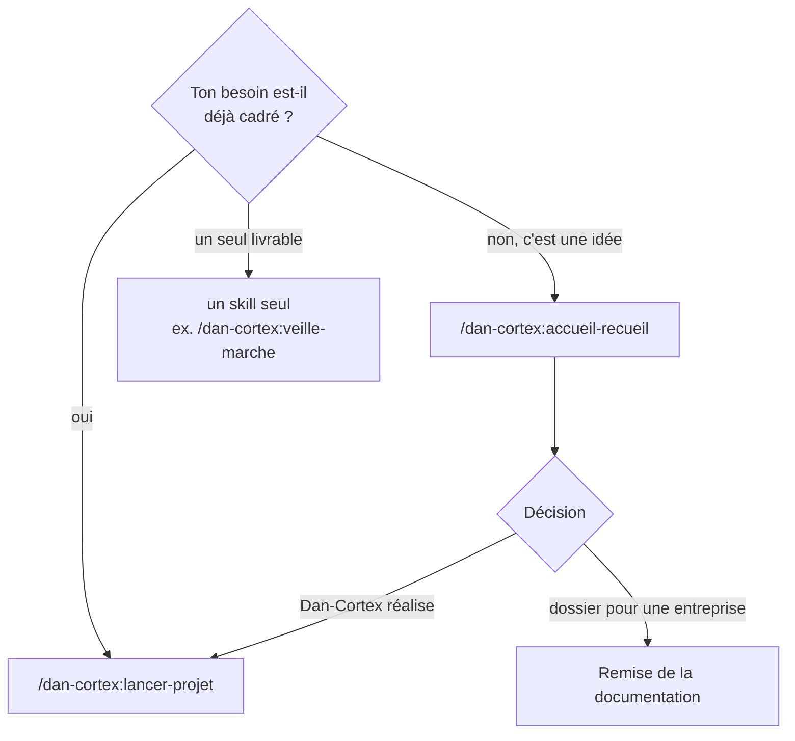
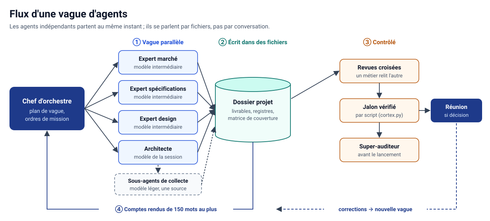

# Guide de démarrage

Ce guide mène de l'installation au premier jalon franchi. Compter une dizaine de minutes, hors temps de travail
des agents.

## Sommaire

1. [Installer le plugin](#1-installer-le-plugin)
2. [Choisir sa porte d'entrée](#2-choisir-sa-porte-dentrée)
3. [Lancer un premier projet](#3-lancer-un-premier-projet)
4. [Régler le mode et l'autonomie](#4-régler-le-mode-et-lautonomie)
5. [Suivre, reprendre, s'arrêter](#5-suivre-reprendre-sarrêter)
6. [Utiliser Dan-Cortex hors de Claude](#6-utiliser-dan-cortex-hors-de-claude)
7. [Dépannage](#7-dépannage)

## 1. Installer le plugin

| Environnement | Marche à suivre |
|---|---|
| Claude Code | `/plugin marketplace add aksilsmd/cortex` puis `/plugin install dan-cortex@cortex-projets` |
| Application Claude (web, bureau) | **Customize** → **Plugins** → **Add** → **Add marketplace** → **Add from a repository** → `aksilsmd/cortex`, puis **dan-cortex** → **Add** |
| Archive | télécharger [`dist/dan-cortex.plugin`](../dist/dan-cortex.plugin) et la téléverser comme plugin personnalisé |

Prérequis : Python 3.11 ou plus pour les scripts (bibliothèque standard uniquement). Sans Python, le chef
d'orchestre tient les registres à la main, pour plus de tokens. L'évaluation live du pôle `robustesse-agents`
demande en plus le CLI `claude`. Les skills `docx`, `pdf`, `pptx`, `xlsx` et voisins utilisent leurs propres
dépendances (LibreOffice, Node, Playwright) : voir leur `SKILL.md`.

Vérifier l'installation : taper `/dan-cortex:` dans Claude doit proposer la liste des skills.

## 2. Choisir sa porte d'entrée



- **`/dan-cortex:accueil-recueil`** : pour partir d'une idée floue. Il salue, reformule, fait valider, explore
  le domaine sur le web et GitHub, propose, mène un entretien à réponses suggérées (« Je ne sais pas, décide pour
  moi » est toujours une option), puis remet cahier des charges, étude de marché, planning et étude de
  réalisation.
- **`/dan-cortex:lancer-projet`** : pour piloter un projet de bout en bout.
- **Un skill seul** : pour un livrable précis (un audit, une étude de marché, un cahier des charges).

## 3. Lancer un premier projet

```
/dan-cortex:lancer-projet Je veux lancer un SaaS de prise de rendez-vous pour kinésithérapeutes, en France,
avec 30 k€ et quatre mois. Commence par l'étude d'opportunité, en mode éclair.
```

Ce qui se passe ensuite :

1. **J0 — Qualification.** Une seule série de questions : périmètre confié, mode, pays, données sensibles,
   niveau d'autonomie. Si tu ne réponds pas, le chef d'orchestre écrit des hypothèses et reste en `eclair`.
2. **Création du dossier projet** par `cortex.py init` : arborescence `00-pilotage/` à `07-exploitation/`,
   matrice de couverture filtrée selon le type de projet et ses étiquettes (`fr`, `b2c`, `paiement`, `ia`…).
3. **Plan annoncé** : agents de la première vague, livrables, coût estimé. Rien ne part avant ton accord en mode
   `standard` ou `integral`.
4. **Vagues d'agents**, puis compte rendu, décisions à prendre et jalon vérifié par script.



## 4. Régler le mode et l'autonomie

| Mode | Pour quoi | Agents par vague | Coût relatif |
|---|---|---|---|
| `eclair` | valider une idée, petit projet | 3 à 4, rôles fusionnés | 1 |
| `standard` | le cas général | 6 à 8 | environ 2 à 3 |
| `integral` | grand compte, secteur régulé | 10 à 16 | environ 2 à 3 fois `standard` |

| Autonomie | Quand le chef d'orchestre s'arrête |
|---|---|
| `accompagne` (défaut) | à chaque jalon, et à chaque décision irréversible |
| `delegue` | à la fin de chaque jalon, décisions regroupées |
| `autonome` | une seule fois, au bilan final ; décisions irréversibles au statut provisoire |

En `autonome`, écris à J0 tes **autorisations permanentes** (effet, cible exacte, limite), par exemple « push sur
la branche `dev` du dépôt X ». Les six limites dures restent hors délégation : voir
[sécurité et robustesse](securite-et-robustesse.md#limites-dures).

Changer en cours de route : `cortex.py etat --set autonomie=delegue`.

## 5. Suivre, reprendre, s'arrêter

Le script se lance depuis le skill `lancer-projet` (`python3 <skill>/scripts/cortex.py …`) :

| Besoin | Commande |
|---|---|
| Où en est-on ? | `etat` |
| Tableau de bord | `tableau-de-bord` |
| Barres d'avancement | `avancement afficher` |
| Ce qui reste ouvert | `registre constats liste --ouverts` |
| Jalon franchissable ? | `jalon verifier J2` |
| Plafond de tokens | `etat --set plafond_tokens=<n>` (alerte à 80 % et 100 %) |

Un grand projet dépasse une session : travaille dans un dossier persistant. Pour reprendre, relance
`/dan-cortex:lancer-projet` dans le même dossier : le chef d'orchestre lit `00-pilotage/cortex.json` et repart
de la dernière vague notée. Tu peux t'arrêter à n'importe quel jalon : une étude d'opportunité seule est un
résultat complet.

## 6. Utiliser Dan-Cortex hors de Claude

- **IA qui lit le dépôt** (Codex, Gemini CLI, Antigravity) : [`AGENTS.md`](../AGENTS.md) explique quels fichiers
  suivre et comment jouer les rôles en séquence si l'outil ne lance pas de sous-agents.
- **Simple chat** : colle `dan-cortex/universel/DAN-CORTEX-NOYAU.md` (moins de 8 000 caractères) ou joins
  `DAN-CORTEX-COMPLET.md`. Mode d'emploi : [`dan-cortex/universel/INSTALLATION.md`](../dan-cortex/universel/INSTALLATION.md).

## 7. Dépannage

| Symptôme | Cause probable | Remède |
|---|---|---|
| `/dan-cortex:` ne propose rien | plugin non installé ou désactivé | réinstaller ; vérifier `/plugin` |
| Un skill ne se déclenche pas tout seul | trop de skills chargés dans la session | l'appeler par sa commande |
| Deux fois les mêmes skills | ancien plugin `cortex` encore installé | le désinstaller |
| `cortex.py` introuvable ou en erreur | Python absent ou trop ancien | installer Python 3.11 ou plus |
| Fenêtre d'utilisation épuisée | vague trop large | mode `eclair`, plafond de tokens, vague pilote |

D'autres questions : [FAQ](faq.md).
